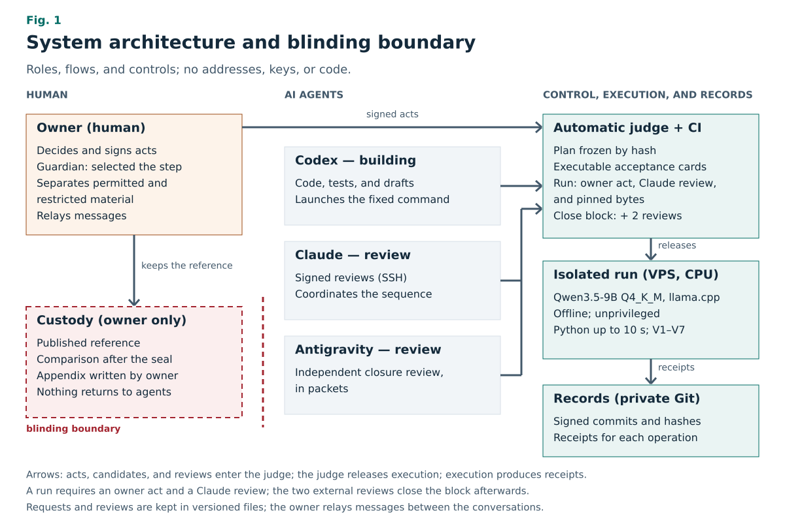
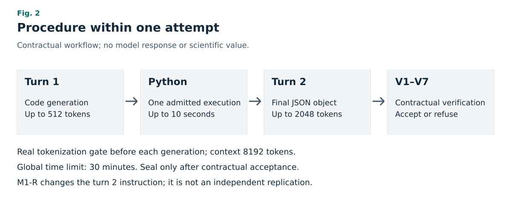
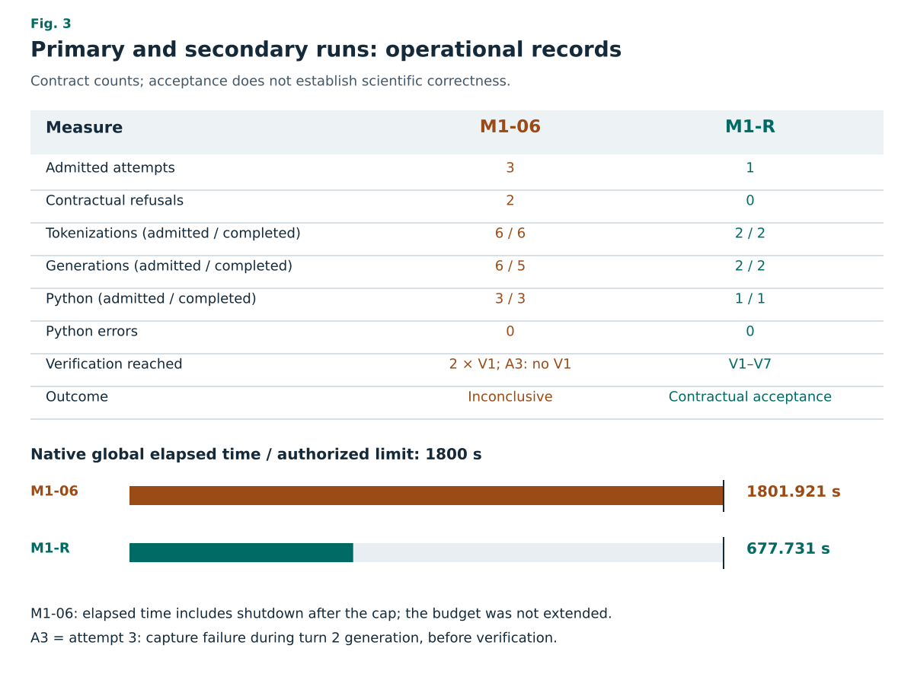

# Blinded, contract-verified reproduction of a published computational step by a local 9B language model: architecture and case study

**Título em português:** Reprodução cega e verificada por contrato de uma etapa computacional publicada por um modelo de linguagem local de 9B: arquitetura e estudo de caso

**Review version — 2 November 2026.** Derived from blinded body version 2, frozen before any comparison with the reference. The architecture description, the task description, the glossary, and the related work were added later, without changing outcomes, numbers, or limits. This is not publication, block closure, or scientific validation.

**Sole human author:** [OWNER TO COMPLETE: publication name]. **ORCID:** [OWNER TO COMPLETE: identifier or state none]. **Affiliation:** [OWNER TO COMPLETE: institution or independent researcher]. **Correspondence:** [OWNER TO COMPLETE: public contact address].

## Abstract

**Objective:** To test whether an automated research system running a small, locally hosted language model can reproduce one computational step of a published work under rules fixed before execution, without any agent having access to the published answer.

**Methods:** We describe an architecture in which AI agents build, run, and review the work; an automatic judge requires a signed act from the human owner for any change of criteria and two external reviews to close each block of work; and the reference answer stays in human custody, out of the agents' reach. The selected step was the scientific energy gain of a National Ignition Facility shot, a ratio of two energies. The evaluated model was Qwen3.5-9B, quantized to 4 bits and run on CPU without network access. Each attempt had two turns: the model wrote code, the system executed it once in Python, and the model delivered a JSON object in the contract format. Seven automatic checks (V1–V7) decided acceptance, under a global limit of 30 min.

**Results:** The primary run ended inconclusively: two outputs were rejected for a JSON-object format error and the third attempt was stopped by the time limit, without an accepted output. Subsequent analysis showed misplaced keys and no sign of truncated output. A secondary run, selected after the failure and registered before execution, repeated the required format as an explicit skeleton and was accepted on its first attempt, with no rejections and no Python errors. The blinded text was frozen before the comparison, which only the owner performed; its outcome is not part of this body.

**Conclusion:** The architecture recorded, end to end, an inconclusive primary run and an accepted secondary run, kept separate. The data do not establish scientific correctness, an isolated causal effect of the instruction, independent replication, or general investigative ability.

**Keywords:** automated research; language models; computational reproducibility; blinding; deterministic verification; case study.

## Resumo

**Objetivo:** Verificar se um sistema de pesquisa automatizada, executado com um modelo de linguagem pequeno e local, consegue reproduzir uma etapa computacional de um trabalho publicado sob regras fixadas antes da execução, sem que nenhum agente tenha acesso à resposta publicada.

**Métodos:** Descrevemos uma arquitetura em que agentes de IA constroem, executam e revisam o trabalho; um juiz automático exige ato assinado do dono humano para qualquer mudança de critério e duas revisões externas para fechar cada bloco de trabalho; e a resposta de referência fica sob custódia humana, fora do alcance dos agentes. A etapa escolhida foi o ganho científico de energia de um disparo do National Ignition Facility, uma divisão entre duas energias. O modelo avaliado foi o Qwen3.5-9B, quantizado em 4 bits e executado em CPU, sem rede. Cada tentativa tinha dois turnos: o modelo escrevia código, o sistema o executava uma vez em Python e o modelo entregava um objeto JSON no formato do contrato. Sete verificações automáticas (V1–V7) decidiam o aceite, com limite global de 30 min.

**Resultados:** A corrida primária terminou inconclusiva: duas saídas foram recusadas por erro de formato do objeto JSON e a terceira tentativa foi interrompida pelo limite de tempo, sem saída aceita. A análise posterior mostrou chaves fora do lugar, sem sinal de corte da resposta. Uma corrida secundária, escolhida depois da falha e registrada antes de rodar, repetiu o formato exigido como esqueleto explícito e foi aceita na primeira tentativa, sem recusas e sem erros Python. O texto cego foi congelado antes da comparação, feita só pelo dono; o resultado dela não integra este corpo.

**Conclusão:** A arquitetura registrou de ponta a ponta uma primária inconclusiva e uma secundária aceita, separadas. Os dados não estabelecem correção científica, efeito causal isolado da instrução, réplica independente ou capacidade geral de investigação.

**Palavras-chave:** pesquisa automatizada; modelos de linguagem; reprodutibilidade computacional; cegamento; verificação determinística; estudo de caso.

## 1. Introduction

AI systems already generate hypotheses, write code, run experiments, and draft manuscripts. Recent examples include multi-agent systems for hypothesis generation [13], pipelines that go from idea to paper [14], and agents that improve algorithms with automated evaluators [15]. Benchmarks measure agents' ability to reproduce computational results of papers [16], to replicate machine learning research [17], and to solve unpublished theoretical physics problems [18].

Computational reproduction requires explicit inputs, a verifiable procedure, and criteria distinguishing a plausible answer from documented execution [1,2]. When AI agents take part, two further requirements arise. First, the contributions of the model must be separated from those of tools and people. Second, the known answer must not influence those who execute or verify. In benchmarks, the reference answer usually rests with the evaluators and performance is measured across many tasks, often with frontier models and network access.

This study asks whether an architecture with a small, local, offline model can produce, for a single published step, its own output, a blinded interpretation, and a verifiable record, within criteria fixed before execution and with the published answer out of reach of every agent. It does not seek to demonstrate discovery, reproduce an entire paper, claim statistical superiority, or general automation of science.

The contributions are:

1. An architecture that separates building, execution, verification, and comparison, with an automatic judge, acts signed by the owner, and the reference answer in human custody (Section 3).
2. A step contract with deterministic verification (V1–V7) that requires captured execution, not merely a plausible answer (Section 4).
3. A case study with a 9B model at 4 bits, on CPU and offline, with a complete record of failures, incidents, and deviations (Section 5).
4. Separate reporting of an inconclusive primary run and of a secondary intervention preregistered after the failure, without reclassifying the primary run.

The bibliographic reference selected in the design is Wurzel and Hsu (2025), arXiv:2505.03834v6 [3]. This identification acknowledges prior work; it neither reproduces its results nor uses a restricted comparison to guide the investigation. Execution fidelity, contractual consistency, and external comparison are distinct questions.

**Box 1. Glossary.**

| Term | Meaning in this article |
|---|---|
| Owner and guardian | The person responsible for the project. Decides, signs the acts, selected the step, separated permitted from restricted material, and alone performed the comparison with the reference. |
| Agents | Codex (building and execution), Claude (review and coordination), and Antigravity (review). They are AI assistants, distinct from the evaluated model. |
| Evaluated model | Qwen3.5-9B, the object of the experiment, run locally. |
| Judge | Program that checks the plan, the acceptance cards, and the reviews before closing any block. |
| Block and acceptance card | The work is divided into sequential blocks; each item has a card with executable checks. |
| Act | An owner decision recorded in a file and confirmed by the owner's own commit, with a signature verified by the platform. |
| M1 contract | Rules for the step: inputs, operations, output format, checks, and stopping conditions. |
| Attempt and rejection | An attempt is one two-turn cycle, which can be interrupted before it ends; a rejection is the verifier refusing the output. |
| Seal | Hash record of the accepted output; it exists only after acceptance. |
| M1-06 and M1-R | Primary run (M1-06) and secondary run with an explicit format (M1-R). |
| Qualification | Earlier test of the model with invented tasks, outside the domain of the step. |
| Custody and appendix | Restricted material and comparison, kept only with the owner; the guardian's appendix is written by the owner, outside this body. |

## 2. Related work

**AI research systems.** Co-Scientist uses several agents on a frontier model to generate, critique, and refine hypotheses, with experimental validation in biomedicine [13]. The AI Scientist chains idea generation, code, experiments, writing, and an automated reviewer [14]. AlphaEvolve combines language models with automated evaluators in an evolutionary code-editing loop [15]. These systems operate at large scale and with frontier models; this study examines a single step, with a small local model.

**Evaluation of agents in reproduction.** CORE-Bench asks agents to reproduce results from the code of published papers [16]. PaperBench asks for the replication of machine learning papers, graded with rubrics [17]. TheoPhysEval presents unpublished theoretical physics problems with verifiable answers and observes little change in performance when web search and background papers are removed, which the authors read as memorization of the literature [18]. In these works, the answer is known to the evaluators. Here, the verifier does not know the published answer, and the comparison rests with a person who does not take part in execution.

## 3. System architecture

**Figure 1. System architecture and blinding boundary.** Roles, flows, and controls, without addresses, keys, or code. The agents build, run, and review. A run starts only with an owner act, a signed review by Claude, and bytes pinned by hash; the two external reviews apply to closing the block, after the runs. Model execution is isolated and offline; the reference and the comparison stay with the owner alone.

### 3.1 Roles

The **owner** is the only human in the flow. The owner decides, signs the acts and, in this study, also serves as **guardian**: the owner selected the step, separated permitted from restricted material, and performed the final comparison. Three **AI agents** work under the owner's instructions. Codex writes the code, the tests, and the preliminary texts, prepares candidates, and launches executions through the fixed command. Claude reviews each candidate, coordinates the sequence, and signs its reviews. Antigravity performs the second, independent review, in packets. Messages between the agents' conversations are relayed by the owner, and requests and reviews are kept in versioned files.

### 3.2 Plan, judge, and acts

The work follows a plan of sequential blocks, frozen by hash; this study corresponds to block 5. Each item has an acceptance card with executable checks: file checks, commands with expected output, negative cases that must fail, and lines that the reviews must contain. An **automatic judge** checks the plan, the cards, and the reviews and refuses any unrecorded change. Changes to criteria, execution code, or the plan take effect only with an owner **act**: a text reviewed by Claude and confirmed by the owner's commit in the GitHub interface, with a signature verified by the platform. Every code candidate goes through continuous integration (CI), which runs the test suite and the card checks. Before each run, the controller checks the owner act, Claude's signed review of the code and the preparation, the bytes pinned by hash, and the passed qualification. A block is closed only later, with the external reviews by Claude and Antigravity; the secondary run was accepted while Antigravity's closure review was still pending.

### 3.3 Isolated execution

Inference takes place on a VPS, on CPU. The model runs through llama.cpp in transient system units, under an unprivileged user, with files mounted read-only, without network access, and with limits on CPU quota, memory, and number of processes. Before each generation, the real tokenizer checks the bytes and the token count. An external **collector** captures the generated code, stdout, stderr, exit status, and duration of each Python execution, which is also isolated and limited to 10 s, and binds everything by hash. The model cannot claim an execution that the collector did not record. A **verifier** applies checks V1–V7 to the output and the captures.

### 3.4 Custody and blinding

The published answer never enters the repository or the agents' conversations. The guardian gave the agents only the permitted material (scope, contract, format examples, and list of constants). The comparison with the reference was performed only by the owner, in a separate conversation, after the seal and after the blinded text was frozen. No reference answer, difference, verdict, or hint returns to investigators, verifiers, or writers, not even after the run. The appendix with the comparison is written and translated by the owner, outside this body.

### 3.5 Records and audit

The records are kept in a private Git repository and on the VPS. Claude's reviews are commits with SSH signatures; the owner's acts are commits with signatures verified by the platform; plan changes are appended to a record without deletion; receipts with hashes bind each execution, tokenization, and capture. The supplement lists versions and hashes.

## 4. Methods

### 4.1 Task

The step was to compute the **scientific energy gain**, Q_sci, of shot N230729 of the National Ignition Facility (NIF), a laser-driven inertial confinement fusion experiment: the ratio of the released fusion energy (Y) to the laser energy (E_in), Q_sci = Y/E_in, in the energy-based definition used in the source work [3]. The two inputs, in joules, were extracted by the custodian from the authors' data package and delivered in the contract with their literal provenance. The output is dimensionless, in double precision and also with three significant figures, accompanied by an interpretation sentence chosen by rule: greater than, less than, or equal to 1. There is no unit conversion and no physical constant; the list of constants is empty.

The step is deliberately simple. Selection required inexpensive deterministic computation, reduced exposure to restricted material, an equation available as a method, and an output accompanied by a blinded interpretation. The object of the study is the complete procedure (contract, isolation, capture, verification, and blinding), not the scientific difficulty of the calculation. The numerical input values, the model's output, and the comparison with the published value are in the guardian's appendix; this body does not contain them.

### 4.2 Design and prospective record

The design was a guided reproduction of a known method, restricted to one CPU step. The permitted contract has SHA-256 `17929806202c7a4ceb2bb752996eeffac7af9e001943938d4422a01f5216af63`. Dates, criteria, tolerances, versions, and hashes appear in Supplement S1. A private freeze before execution is not equivalent to public preregistration [4].

The study unit is one step. Internal attempts do not increase sample size; primary M1-06 and secondary M1-R are not independent replications. The earlier qualifications used invented tasks, which do not count as scientific observations of the step.

### 4.3 Environment and procedure

The evaluated object was Qwen3.5-9B, Q4_K_M quantization, under a non-reasoning profile, run locally through the CPU route of llama.cpp b11960 [5,6]. The supplement fixes revisions and hashes for weights, executables, tokenizer, and profiles. No commercial model was used to investigate the step; construction and review assistants are disclosed separately.

In turn 1, the model supplied code in an admissible format. The collector captured code, stdout, stderr, exit status, and duration, bound by hashes. Each admitted attempt allowed one Python execution limited to 10 s. In turn 2, the model received the permitted history and the recorded stdout to produce the final JSON object. The model's declaration did not replace capture; hash consistency and qualification of capture origin are distinct requirements.

The global budget was 30 min, context was 8192 tokens, and generation limits were 512 and 2048 tokens for turns 1 and 2, respectively. The real tokenizer checked bytes and count for each call before generation. Temperature was zero. Counters belonged to the contract; admitted and completed operations are distinguished. No run was relaunched to replace its terminal state. The supplement precisely defines the three threads and other parameters.

**Figure 2. Contractual workflow within one attempt.** Two generation turns, one admitted Python execution, and V1–V7 verification. The tokenization gate precedes each generation. The diagram presents the procedure, not a model response.

### 4.4 Verification and stopping conditions

The verifier applied V1–V7 sequentially to the permitted contract and independently captured records, without knowing any published answer. Both primary rejections stopped at V1: V2–V7 received neither a pass nor a failure. Check V4 recomputes Y/E_in from the scope and allows a relative difference of at most 10⁻⁹. The comparison with the published reference, performed only by the custodian, uses a tolerance of 1%, fixed in the contract before any result.

| Criterion | Target | Limit of the conclusion |
|---|---|---|
| V1 | Structure and types of the final object | Format does not demonstrate execution. |
| V2 | Step, formula, and permitted units | Depends on the frozen contract. |
| V3 | Inputs and provenance | Does not consult a restricted answer. |
| V4 | Consistency with the permitted relation | Does not compare with a reference answer. |
| V5 | Numerical representation | Rounding does not justify precision. |
| V6 | Code, capture, stdout, and object | Requires a documented external origin. |
| V7 | Blinded interpretation of its own output | Receives no custody information. |

The contract defines three outcomes. **Accepted:** the verifier passes V1–V7; the output is sealed and there is no new attempt. **Inconclusive:** three rejected outputs, three execution errors, or 30 min without an accepted output; there is no repetition "until it works". **Incident:** immediate interruption by owner order, access outside the batch, or a number without origin. SI units and notation are used [10,11]; times are operational metadata, not physical precision. No Lean proof exists. Synthetic tests and hashes alone do not demonstrate authorship, execution, scientific correctness, or independence.

### 4.5 Earlier qualifications

Before the step, the model went through a qualification with three short invented tasks (adding two numbers, counting the elements of a list, and sorting three words), each with an exact answer in a JSON object, repeated three times. The rule, fixed before execution, required all nine outputs to be correct. After the failure, a second qualification was selected, with different tasks involving rule adherence, format, and explicitly specified simple code.

### 4.6 Custody, blinding, and editorial sequence

The owner assumed the scientific guardian role. This is a declared deviation from a design envisaging a different person: the guardian and comparison recipient are the same person. Independent custody is not claimed.

The rule prohibits restricted references, differences, verdicts, hints, and answer-derived corrections from returning to investigators, verifiers, and writers. It covers files, history, records, memory, backups, tools, and networks; separate prompts or directories do not establish isolation. Absence of prior knowledge in the weights was not demonstrated, nor was technically qualified blinding established merely by this rule.

The first version of the blinded text (v1) was preserved. Version 2 incorporated the format analysis, the secondary run, and prospective disclosure of the guardian's exploratory analysis, and was frozen before any comparison. The owner subsequently reported completing the comparison in custody. Only that fact was recorded: no content, difference, or outcome returned to agents.

### 4.7 Deviations and secondary intervention

The second qualification was selected after the first failed, using different tasks. Incidents 04 and 05 were preserved. After M1-06, an authorized analysis examined key names and boolean values in preserved records, without executing a model, tokenizer, or generated code.

M1-R was chosen after that analysis and registered before execution. In turn 2, it repeated the required format, already present in the contract, as a JSON skeleton with exact names and empty fields, without copying a rejected answer, inserting values, or providing scientific hints. With no evidence of truncation, neither a block-based variant nor harness assembly of the answer was adopted. Model, package, contract, inputs, verifier, tolerance, profile, limits, counters, and blinding were preserved. The intervention was not planned before the primary run and does not reclassify it.

## 5. Results

### 5.1 Inconclusive primary run

M1-06 had one invocation and three admitted internal attempts. The first two reached final validation and were rejected; the third ended during turn 2 generation with `supervisor_timeout; deadline_exceeded`. The controller's native state remained `incidente`, with no active attempt or seal, because the third generation was cut at the limit. Under the contract rule, the outcome was inconclusive: 30 min without an accepted output, after two V1 rejections. The dedicated Python error counter was zero; this does not mean that no operational incident occurred.

Six tokenizations and six generations were admitted. All tokenizations and five generations completed operationally. The supervisor did not accept the last generation even though the subprocess returned zero. All three Python executions recorded operational completion. The monotonic interval was 1801.921 s, including shutdown and recording after the limit, without an authorized budget extension. Supplementary Figure S1 shows the recorded timestamps of each attempt.

The controller preserved the bytes but did not persist each rejection's exception code. Subsequent classification reapplied only pure capture and verification functions from the fixed version to preserved, hash-checked files. Both rejections were `V1_chaves`, that is, the set of keys in the JSON object differed from the schema; V2–V7 were not reached.

| Turn 2 metadata | First rejection | Second rejection |
|---|---|---|
| Native / expected input tokens (P) | 3530 / 3530 | 3530 / 3530 |
| Generated tokens, including end of generation (G) | 320 | 320 |
| Reached 2048 tokens | No | No |
| End-of-generation suffix present | Yes | Yes |
| Valid boundary | Yes | Yes |
| Capture reason | `eog_contagem_vinculada` | `eog_contagem_vinculada` |

### 5.2 Analysis of the format failure

The analysis and review classified the rejections as model behavior within the contract. The two final outputs had the same hash. They had extra `schema` and `codigo` keys at the root and lacked `calculo.codigo`; the other inspected key sets matched the schema. Capture showed no evidence of truncation.

Internal checks indicated equality between inputs and scope, between the numerical output field and the first stdout line, between the formatted string and the second line, and between raw output and complete stdout. Code at the root matched captured code. No untraceable number was found in inspected numerical JSON fields or entirely numeric scalar strings. This narrow finding does not semantically audit all prose, use an external reference, reclassify V1–V7, or establish scientific correctness.

Across all three attempts, hashes matched for the turn 1 response, code, Python stdout, and turn 2 input. This dependence and zero temperature prevent treating attempts as independent replications or as an estimate of success rate.

### 5.3 Earlier qualifications and incidents

Primary qualification B05-02 **FAILED, 6/9**, under the rule fixed before execution. The later second qualification, with different tasks, passed, 9/9. It neither replaces the first nor demonstrates general scientific ability.

Incident 04 arose during turn 2 rendering after real operations; incident 05 arose from invocation with an external lock and involved zero model operations. These are preserved operational incidents, not scientific responses. Their resource use was neither erased nor artificially incorporated into the primary run.

### 5.4 Contractually accepted secondary run

M1-R had one invocation without an external relaunch. It ended as `aceita` on its first attempt, with zero rejections and zero Python errors. Two tokenizations, two generations, and one Python execution were admitted and completed. The monotonic interval was 677.731 s, within 30 min.

The native seal records V1–V7. Documentary hash checks established consistency among the seal, terminal state, freeze, outputs, code, stdout, stderr, receipts, and independent captures. They neither repeated the verifier nor compared output with the reference. The 101 raw files, totaling 342031 bytes, were preserved. This body contains metadata and hashes; it contains no scientific value, prompts, model text, generated code, or scientific stdout.

At the version 2 freeze, independent review of the secondary run was pending. A later administrative update records Claude's review of seal consistency and outcome. M1-R remains secondary, not an independent replication or scientific validation.

**Figure 3. Operational records of the primary and secondary runs.** Admitted and operationally completed counts are distinct. M1-06 had two V1 refusals and an operational interruption in its third attempt; M1-R reached V1–V7 and contractual acceptance. The primary duration of 1801.921 s includes shutdown after the 1800 s cap, without additional authorization; the secondary duration was 677.731 s. This presentation is neither a scientific comparison nor a causal test.

### 5.5 Restricted comparison

The guardian's exploratory analysis was chosen after failure, with the same 1% tolerance, and disclosed before comparison. Its scope included the number printed by Python and the number in the rejected response. The owner subsequently reported completing the comparison. No exploratory result, difference, or comparative verdict is claimed in this body. The primary run remains inconclusive, without retrospective acceptance. Supplementary Figure S2 shows the order of contract, runs, freeze, and comparison.

## 6. Discussion

The primary outcome documents the absence of an accepted response under the fixed contract and budget. Locating the rejections at V1 and the termination in temporal control identifies the workflow failure but does not decide the scientific correctness of rejected content. Valid capture, a zero exit status, and activity do not equal acceptance.

In the primary run, the turn 2 instruction referred to the schema by filename; the schema was present in the permitted history. This pre-run choice was not classified as a controller defect. It is a plausible procedural limitation: under the selected profile, the 9B model did not reproduce the available schema. Subsequent analysis located a mixture of the first-turn format and the final schema. Because the step required only a division, the recorded failure lies in adherence to the format of the final object; the calculation was executed by Python and was not the cause of the rejections.

The secondary run recorded acceptance after making the schema explicit. Because the intervention was chosen after failure and applied to the same problem, the observation does not identify an isolated causal effect of the instruction. It does not show that another instruction would change the primary run, increase independent samples, or support generalization to other problems or models.

Relative to related work, the architecture trades scale for control. Systems such as [13–15] operate at scale, with automated or experimental evaluation; recent benchmarks evaluate many tasks, usually with frontier models, and the reference answer rests with the evaluators [16–18]. Here there is a single step, a small offline model, and an answer kept out of reach of those who execute and verify. This design does not measure an accuracy rate, but it makes every step auditable, including the failures. The memorization reported for frontier models [18] reinforces limitation 2: this study does not exclude prior knowledge in the weights.

Efficiency requires an appropriate comparator. Execution intervals exclude parts of preparation, implementation, review, failures, and human effort, and are not compared with an assumed discovery time for the original authors. This report distinguishes execution, rejection, contractual acceptance, and external comparison without converting one category into another.

## 7. Limitations

1. **One step and dependence.** No general success rate, causal effect, or statistical superiority is estimated. The secondary run is post hoc relative to the primary run.
2. **Prior knowledge and containment.** It was not demonstrated that the weights were unfamiliar with the source work. Self-hosting and file absence do not remove learned knowledge; a blinding rule does not prove comprehensive isolation.
3. **Custody and interest.** The owner combined custody with receipt of the comparison. Functional separation does not create personal independence.
4. **Reviews.** Assistants, code review, and documentary consistency do not replace a human domain specialist. Pending formal reviews are not favorable verdicts.
5. **Environment and scope.** CPU acceptance does not qualify CUDA, another driver, precision, or a GPU campaign. Broad verification and GPU work are future stages not performed within this scope. No Lean proof exists.
6. **Preservation and access.** Hashes and private records bind evidence but do not guarantee truth, comprehensive autonomy, recovery of unsaved memory, or public reproducibility access. Release depends on the owner.
7. **Science.** No comparative outcome, scientific correctness, or discovery is reported in this body. Lack of acceptance does not establish correct or incorrect content.

## 8. Conclusion

The primary run ended inconclusively, without an accepted output in 30 min, after two V1 rejections and temporal termination of the third attempt. A secondary intervention, chosen after the format analysis and registered before execution, obtained contractual acceptance on its first attempt. The outcomes remain separate. The evidence describes the behavior and traceability of a bounded procedure; it does not establish scientific correctness, independent replication, or general investigative ability.

## Authorship, contributions, and AI assistance

Authorship and responsibility for the submitted version will be exclusively human. AI systems are not authors [7,8]. This text, including its translation, was prepared with AI assistance; final human review and approval remain pending.

Codex assisted with programming, evidence organization, drafting of the earlier versions, and translation; Claude assisted with review, coordination, and the editorial restructuring of this version. Antigravity is part of the review route, but its formal closure review of block 5 was not completed in this edition. These roles are neither specialist human review nor authorship attribution. Qwen3.5-9B was the experimental object, distinct from these assistants. Exact assistant model and version identification by session should accompany the tool record before submission; a product name does not establish a version.

**CRediT [9] — proposed roles for human author confirmation:** conceptualization (scope decisions); methodology (design decisions and authorizations); project administration; supervision; data curation (restricted custody); writing — review and editing, only after actual final review. Programming, formal analysis, or human validation are not automatically attributed to the author. [OWNER TO COMPLETE: confirm actual contributions and approve responsibility for the final text]. CRediT describes contributions; it does not alone determine authorship eligibility.

## Declarations

**Funding:** [OWNER TO COMPLETE: identify funders, grants, and material support, or confirm no external funding].

**Competing interests:** [OWNER TO COMPLETE: disclose relevant financial, institutional, or personal interests, or confirm none]. The combined owner and guardian roles are already disclosed in the methods.

**Ethics:** the described procedure involves no human participants or animals and collects no participant personal data. Human custody of the project is not an intervention on participants. No ethics committee approval that did not occur is claimed. [OWNER TO COMPLETE: confirm applicable institutional or editorial requirements and report any actual approval or exemption].

**Data and code:** the architecture and records are preserved privately; Section 3 describes the architecture at a functional level, without addresses, keys, or code. The supplement identifies artifacts, versions, and hashes; identification does not imply public access or reproduction by third parties. [OWNER TO COMPLETE: define which permitted code and records will be published, which remain restricted, access conditions, and a permanent address]. The restricted reference, comparison, and appendix will not be provided to agents. The permitted sealed package delivered to the owner is distinct from the blinded body.

**Licence:** CC BY 4.0 is suggested for original text whose release the owner authorizes [12]. [OWNER TO COMPLETE: confirm the licence and covered materials]. Software, weights, and third-party materials retain their own licences; this suggestion does not relicense REFORMS, whose article is CC BY-NC 4.0. The supplementary checklist contains short paraphrased descriptors and an original applicability assessment, without reproducing the entire source table.

**Versions and translation:** this English version and the Portuguese version contain the same scientific content. English is an assisted translation of the Portuguese draft, without additional scientific analysis. [OWNER TO COMPLETE: select the version-of-record language and destination]. Each version should identify and cite the other in the final record. A single DOI record containing both files, where accepted, or a preprint accepting both is suggested; no DOI, submission, or publication has been created. Secondary publication in another journal must follow relevant editorial policies and approvals; translation does not automatically authorize duplicate publication.

## References

1. National Academies of Sciences, Engineering, and Medicine. *Reproducibility and Replicability in Science*. Washington, DC: National Academies Press; 2019. DOI: [10.17226/25303](https://doi.org/10.17226/25303).
2. Kapoor S, et al. REFORMS: Consensus-based Recommendations for Machine-learning-based Science. *Science Advances*. 2024;10(18):eadk3452. DOI: [10.1126/sciadv.adk3452](https://doi.org/10.1126/sciadv.adk3452).
3. Wurzel SE, Hsu SC. Continuing progress toward fusion energy breakeven and gain as measured against the Lawson criteria. *Physics of Plasmas*. 2025;32:112106. DOI: [10.1063/5.0297357](https://doi.org/10.1063/5.0297357). arXiv:2505.03834v6.
4. Center for Open Science. *Preregistration*. [Official resource](https://www.cos.io/initiatives/prereg). Accessed 2026-11-02.
5. Qwen Team; LM Studio Community (GGUF distribution). *Qwen3.5-9B; Qwen3.5-9B-Q4_K_M.gguf*. Distribution revision `1379f25c6b505a3fc737bd7818cb09389cf807c1`. [Versioned repository](https://huggingface.co/lmstudio-community/Qwen3.5-9B-GGUF/tree/1379f25c6b505a3fc737bd7818cb09389cf807c1). Exact artifact identification in Supplement S1.
6. ggml-org. *llama.cpp*. Build b11960; commit `8642541b255bfb5dc39cd351a178be09013a55d6`. [Versioned source](https://github.com/ggml-org/llama.cpp/tree/8642541b255bfb5dc39cd351a178be09013a55d6). Exact executable identification in Supplement S1.
7. International Committee of Medical Journal Editors. *Recommendations: AI Use by Authors*. January 2026 update. [Official recommendations](https://www.icmje.org/recommendations/browse/artificial-intelligence/ai-use-by-authors.html). Accessed 2026-11-02.
8. COPE Council. *COPE position—Authorship and AI—English*. Version 1; 2024. DOI: [10.24318/cCVRZBms](https://doi.org/10.24318/cCVRZBms).
9. National Information Standards Organization. *ANSI/NISO Z39.104-2022: CRediT, Contributor Roles Taxonomy*. 2022. DOI: [10.3789/ansi.niso.z39.104-2022](https://doi.org/10.3789/ansi.niso.z39.104-2022).
10. International Organization for Standardization. *ISO 80000-1:2022: Quantities and units—Part 1: General*. 2nd ed. 2022. [Official catalogue](https://www.iso.org/standard/76921.html).
11. Bureau International des Poids et Mesures. *The International System of Units (SI)*. 9th ed.; 2026 update. DOI: [10.59161/AUEZ1291](https://doi.org/10.59161/AUEZ1291). [Official brochure](https://www.bipm.org/en/publications/si-brochure).
12. Creative Commons. *Attribution 4.0 International: Legal Code*. [Official licence](https://creativecommons.org/licenses/by/4.0/legalcode.en). Accessed 2026-11-02.
13. Gottweis J, et al. Towards an AI co-scientist (later version: Accelerating scientific discovery with Co-Scientist). arXiv:2502.18864; 2025. [arXiv](https://arxiv.org/abs/2502.18864).
14. Lu C, et al. The AI Scientist: Towards Fully Automated Open-Ended Scientific Discovery. arXiv:2408.06292; 2024. [arXiv](https://arxiv.org/abs/2408.06292).
15. Novikov A, et al. AlphaEvolve: A coding agent for scientific and algorithmic discovery. arXiv:2506.13131; 2025. [arXiv](https://arxiv.org/abs/2506.13131).
16. Siegel Z, et al. CORE-Bench: Fostering the Credibility of Published Research Through a Computational Reproducibility Agent Benchmark. *Transactions on Machine Learning Research*. 2024. arXiv:2409.11363. [arXiv](https://arxiv.org/abs/2409.11363).
17. Starace G, et al. PaperBench: Evaluating AI's Ability to Replicate AI Research. arXiv:2504.01848; 2025. [arXiv](https://arxiv.org/abs/2504.01848).
18. Chandra AR, et al. TheoPhysEval: Assessing AI agents at autonomous theoretical physics problem solving. arXiv:2610.16733; 2026. Preprint. [arXiv](https://arxiv.org/abs/2610.16733).

## Guardian's appendix — external placeholder

[APPENDIX PLACEHOLDER — outside the body delivered by the agents.] The appendix, including the comparison figure, was prepared and inserted by the owner after the body was frozen, outside the project.
