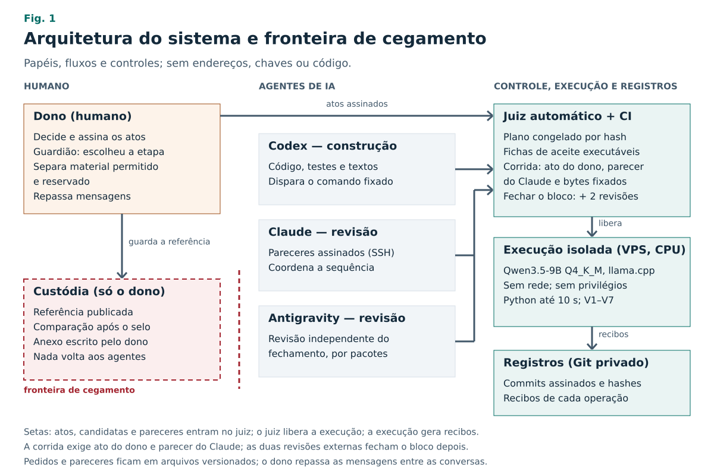
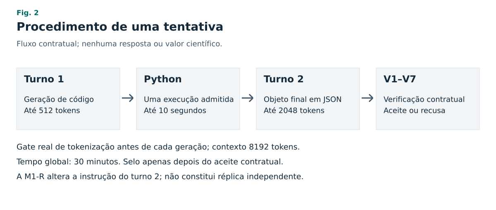
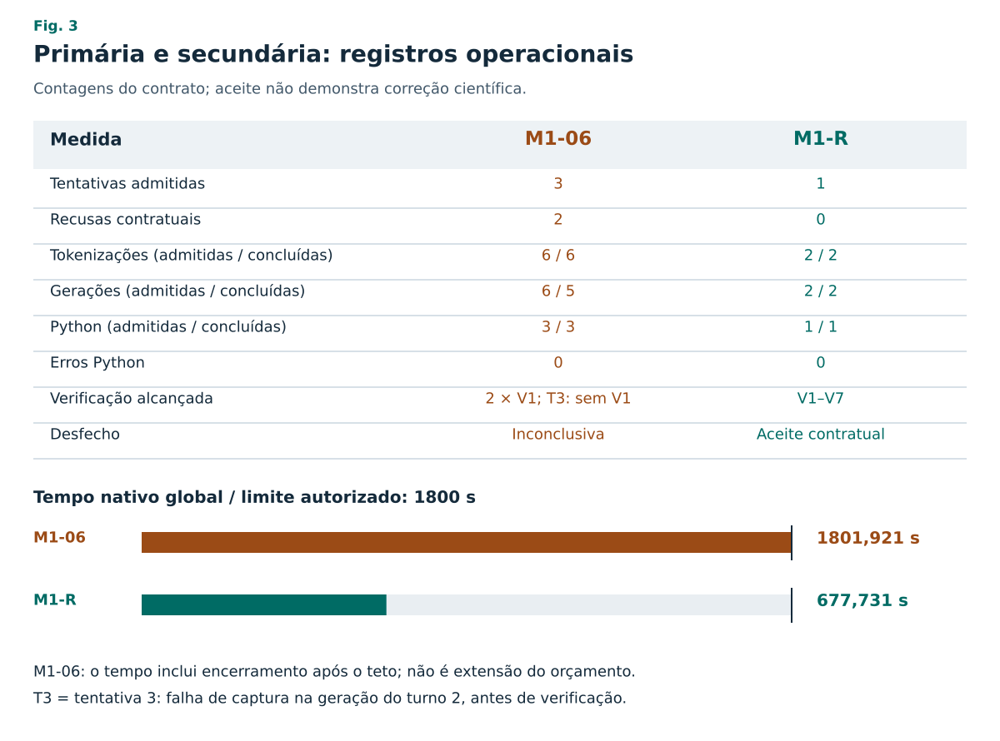

# Reprodução cega e verificada por contrato de uma etapa computacional publicada por um modelo de linguagem local de 9B: arquitetura e estudo de caso

**English title:** Blinded, contract-verified reproduction of a published computational step by a local 9B language model: architecture and case study

**Versão de conferência — 2 de novembro de 2026.** Derivada do corpo cego v2, congelado antes de qualquer comparação com a referência. A descrição da arquitetura, a descrição da tarefa, o glossário e os trabalhos relacionados foram acrescentados depois, sem mudar desfechos, números ou limites. Não é publicação, fechamento de bloco ou validação científica.

**Autor humano único:** [PENDENTE DONO: nome para publicação]. **ORCID:** [PENDENTE DONO: identificador ou informar que não possui]. **Afiliação:** [PENDENTE DONO: instituição ou pesquisador independente]. **Correspondência:** [PENDENTE DONO: endereço público de contato].

## Resumo

**Objetivo:** Verificar se um sistema de pesquisa automatizada, executado com um modelo de linguagem pequeno e local, consegue reproduzir uma etapa computacional de um trabalho publicado sob regras fixadas antes da execução, sem que nenhum agente tenha acesso à resposta publicada.

**Métodos:** Descrevemos uma arquitetura em que agentes de IA constroem, executam e revisam o trabalho; um juiz automático exige ato assinado do dono humano para qualquer mudança de critério e duas revisões externas para fechar cada bloco de trabalho; e a resposta de referência fica sob custódia humana, fora do alcance dos agentes. A etapa escolhida foi o ganho científico de energia de um disparo do National Ignition Facility, uma divisão entre duas energias. O modelo avaliado foi o Qwen3.5-9B, quantizado em 4 bits e executado em CPU, sem rede. Cada tentativa tinha dois turnos: o modelo escrevia código, o sistema o executava uma vez em Python e o modelo entregava um objeto JSON no formato do contrato. Sete verificações automáticas (V1–V7) decidiam o aceite, com limite global de 30 min.

**Resultados:** A corrida primária terminou inconclusiva: duas saídas foram recusadas por erro de formato do objeto JSON e a terceira tentativa foi interrompida pelo limite de tempo, sem saída aceita. A análise posterior mostrou chaves fora do lugar, sem sinal de corte da resposta. Uma corrida secundária, escolhida depois da falha e registrada antes de rodar, repetiu o formato exigido como esqueleto explícito e foi aceita na primeira tentativa, sem recusas e sem erros Python. O texto cego foi congelado antes da comparação, feita só pelo dono; o resultado dela não integra este corpo.

**Conclusão:** A arquitetura registrou de ponta a ponta uma primária inconclusiva e uma secundária aceita, separadas. Os dados não estabelecem correção científica, efeito causal isolado da instrução, réplica independente ou capacidade geral de investigação.

**Palavras-chave:** pesquisa automatizada; modelos de linguagem; reprodutibilidade computacional; cegamento; verificação determinística; estudo de caso.

## Abstract

**Objective:** To test whether an automated research system running a small, locally hosted language model can reproduce one computational step of a published work under rules fixed before execution, without any agent having access to the published answer.

**Methods:** We describe an architecture in which AI agents build, run, and review the work; an automatic judge requires a signed act from the human owner for any change of criteria and two external reviews to close each block of work; and the reference answer stays in human custody, out of the agents' reach. The selected step was the scientific energy gain of a National Ignition Facility shot, a ratio of two energies. The evaluated model was Qwen3.5-9B, quantized to 4 bits and run on CPU without network access. Each attempt had two turns: the model wrote code, the system executed it once in Python, and the model delivered a JSON object in the contract format. Seven automatic checks (V1–V7) decided acceptance, under a global limit of 30 min.

**Results:** The primary run ended inconclusively: two outputs were rejected for a JSON-object format error and the third attempt was stopped by the time limit, without an accepted output. Subsequent analysis showed misplaced keys and no sign of truncated output. A secondary run, selected after the failure and registered before execution, repeated the required format as an explicit skeleton and was accepted on its first attempt, with no rejections and no Python errors. The blinded text was frozen before the comparison, which only the owner performed; its outcome is not part of this body.

**Conclusion:** The architecture recorded, end to end, an inconclusive primary run and an accepted secondary run, kept separate. The data do not establish scientific correctness, an isolated causal effect of the instruction, independent replication, or general investigative ability.

**Keywords:** automated research; language models; computational reproducibility; blinding; deterministic verification; case study.

## 1. Introdução

Sistemas de IA já geram hipóteses, escrevem código, executam experimentos e redigem manuscritos. Exemplos recentes incluem sistemas multiagente para geração de hipóteses [13], pipelines que vão da ideia ao artigo [14] e agentes que melhoram algoritmos com avaliadores automáticos [15]. Benchmarks medem a capacidade de agentes de reproduzir resultados computacionais de artigos [16], de replicar pesquisas de aprendizado de máquina [17] e de resolver problemas inéditos de física teórica [18].

Uma reprodução computacional exige entradas explícitas, procedimento verificável e critérios que distingam resposta plausível de execução documentada [1,2]. Quando agentes de IA participam, surgem duas exigências adicionais. Primeiro, separar o que o modelo fez do que fizeram as ferramentas e as pessoas. Segundo, garantir que a resposta conhecida não influencie quem executa ou verifica. Em benchmarks, a resposta de referência costuma estar com os avaliadores e o desempenho é medido em muitas tarefas, frequentemente com modelos de fronteira e acesso à rede.

Este estudo pergunta se uma arquitetura com modelo pequeno, local e sem rede consegue produzir, para uma única etapa publicada, uma saída própria, uma interpretação cega e uma trilha verificável, dentro de critérios fixados antes da execução e com a resposta publicada fora do alcance de todos os agentes. Não se pretende demonstrar descoberta, reproduzir um artigo inteiro, alegar superioridade estatística ou automatização geral da ciência.

As contribuições são:

1. Uma arquitetura que separa construção, execução, verificação e comparação, com um juiz automático, atos assinados pelo dono e a resposta de referência sob custódia humana (Seção 3).
2. Um contrato de etapa com verificação determinística (V1–V7) que exige execução capturada, e não apenas uma resposta plausível (Seção 4).
3. Um estudo de caso com um modelo de 9B em 4 bits, em CPU e sem rede, com registro integral de falhas, incidentes e desvios (Seção 5).
4. O relato separado de uma corrida primária inconclusiva e de uma intervenção secundária pré-registrada depois da falha, sem reclassificar a primária.

A referência bibliográfica selecionada no desenho é Wurzel e Hsu (2025), versão arXiv:2505.03834v6 [3]. Essa identificação reconhece o trabalho anterior; não reproduz seus resultados nem usa uma comparação reservada para orientar a investigação. Fidelidade da execução, consistência contratual e comparação externa são questões distintas.

**Quadro 1. Glossário.**

| Termo | Significado neste artigo |
|---|---|
| Dono e guardião | A pessoa responsável pelo projeto. Decide, assina os atos, escolheu a etapa, separou o material permitido do reservado e fez sozinha a comparação com a referência. |
| Agentes | Codex (construção e execução), Claude (revisão e coordenação) e Antigravity (revisão). São assistentes de IA, distintos do modelo avaliado. |
| Modelo avaliado | Qwen3.5-9B, objeto do experimento, executado localmente. |
| Juiz | Programa que confere o plano, as fichas de aceite e as revisões antes de fechar qualquer bloco. |
| Bloco e ficha de aceite | O trabalho é dividido em blocos sequenciais; cada item tem uma ficha com verificações executáveis. |
| Ato | Decisão do dono registrada em arquivo e confirmada por commit dele, com assinatura verificada pela plataforma. |
| Contrato M1 | Regras da etapa: entradas, operações, formato da saída, verificações e condições de parada. |
| Tentativa e recusa | Uma tentativa é um ciclo de dois turnos, que pode ser interrompido antes do fim; recusa é a rejeição da saída pelo verificador. |
| Selo | Registro por hash da saída aceita; só existe depois do aceite. |
| M1-06 e M1-R | Corrida primária (M1-06) e corrida secundária com formato explícito (M1-R). |
| Qualificação | Teste prévio do modelo com tarefas inventadas, fora do domínio da etapa. |
| Custódia e anexo | Material reservado e comparação, mantidos só com o dono; o anexo do guardião é escrito por ele, fora deste corpo. |

## 2. Trabalhos relacionados

**Sistemas de pesquisa com IA.** O Co-Scientist usa vários agentes sobre um modelo de fronteira para gerar, criticar e refinar hipóteses, com validação experimental em biomedicina [13]. O AI Scientist encadeia geração de ideias, código, experimentos, redação e um revisor automático [14]. O AlphaEvolve combina modelos de linguagem com avaliadores automáticos num ciclo evolutivo de edição de código [15]. Esses sistemas operam em grande escala e com modelos de fronteira; este estudo examina uma única etapa, com um modelo pequeno e local.

**Avaliação de agentes em reprodução.** O CORE-Bench pede a agentes que reproduzam resultados a partir do código de artigos publicados [16]. O PaperBench pede a replicação de artigos de aprendizado de máquina, com rubricas de correção [17]. O TheoPhysEval apresenta problemas inéditos de física teórica com respostas verificáveis e observa pouca diferença de desempenho quando a busca na rede e os artigos de apoio são retirados, o que os autores leem como memorização da literatura [18]. Nesses trabalhos, a resposta é conhecida por quem avalia. Aqui, o verificador não conhece a resposta publicada, e a comparação fica com uma pessoa que não participa da execução.

## 3. Arquitetura do sistema

**Figura 1. Arquitetura do sistema e fronteira de cegamento.** Papéis, fluxos e controles, sem endereços, chaves ou código. Os agentes constroem, executam e revisam. A corrida só começa com ato do dono, parecer assinado do Claude e bytes fixados por hash; as duas revisões externas valem para o fechamento do bloco, depois das corridas. A execução do modelo ocorre isolada, sem rede; a referência e a comparação ficam só com o dono.

### 3.1 Papéis

O **dono** é o único humano no fluxo. Ele decide, assina os atos e, neste estudo, também atua como **guardião**: escolheu a etapa, separou o material permitido do reservado e fez a comparação final. Três **agentes de IA** trabalham sob suas ordens. O Codex escreve o código, os testes e os textos preliminares, prepara as candidatas e dispara as execuções pelo comando fixado. O Claude revisa cada candidata, coordena a sequência e assina seus pareceres. O Antigravity faz a segunda revisão independente, por pacotes. As mensagens entre as conversas dos agentes são repassadas pelo dono, e os pedidos e pareceres ficam em arquivos versionados.

### 3.2 Plano, juiz e atos

O trabalho segue um plano de blocos sequenciais, congelado por hash; este estudo corresponde ao bloco 5. Cada item tem uma ficha de aceite com verificações executáveis: conferências de arquivos, comandos com saída esperada, negativos que precisam falhar e linhas que os pareceres precisam conter. Um **juiz automático** confere o plano, as fichas e as revisões e recusa qualquer mudança não registrada. Mudanças de critério, de código de execução ou do plano só valem com um **ato** do dono: um texto revisado pelo Claude e confirmado por commit do dono na interface do GitHub, com assinatura verificada pela plataforma. Cada candidata de código passa pela integração contínua (CI), que roda a bateria de testes e as conferências das fichas. Antes de cada corrida, o controlador confere o ato do dono, o parecer assinado do Claude sobre o código e a preparação, os bytes fixados por hash e a qualificação aprovada. Um bloco só é fechado depois, com as revisões externas do Claude e do Antigravity; a corrida secundária foi aceita enquanto a revisão de fechamento do Antigravity ainda estava pendente.

### 3.3 Execução isolada

A inferência ocorre numa VPS, em CPU. O modelo roda pelo llama.cpp em unidades transitórias do sistema, com usuário sem privilégios, arquivos montados somente para leitura, sem rede, com quota de CPU, memória e número de processos limitados. Antes de cada geração, o tokenizador real confere os bytes e a contagem de tokens. Um **coletor** externo captura o código gerado, o stdout, o stderr, o código de retorno e a duração de cada execução Python, também isolada e limitada a 10 s, e vincula tudo por hash. O modelo não pode declarar uma execução que o coletor não tenha registrado. Um **verificador** aplica as verificações V1–V7 à saída e às capturas.

### 3.4 Custódia e cegamento

A resposta publicada nunca entra no repositório nem nas conversas dos agentes. O guardião entregou aos agentes apenas o material permitido (escopo, contrato, exemplos de formato e lista de constantes). A comparação com a referência foi feita só pelo dono, numa conversa separada, depois do selo e do congelamento do texto cego. Nenhum gabarito, diferença, veredito ou dica volta aos investigadores, verificadores ou redatores, nem depois da rodada. O anexo com a comparação é escrito e traduzido pelo dono, fora deste corpo.

### 3.5 Registro e auditoria

Os registros ficam num repositório Git privado e na VPS. Os pareceres do Claude são commits com assinatura SSH; os atos do dono são commits com assinatura verificada pela plataforma; as alterações do plano são acrescentadas a um registro sem apagamento; recibos com hash vinculam cada execução, cada tokenização e cada captura. O suplemento lista versões e hashes.

## 4. Métodos

### 4.1 Tarefa

A etapa foi calcular o **ganho científico de energia**, Q_sci, do disparo N230729 do National Ignition Facility (NIF), um experimento de fusão por confinamento inercial com laser: a razão entre a energia de fusão liberada (Y) e a energia do laser (E_in), Q_sci = Y/E_in, na definição em base de energia usada no trabalho de origem [3]. As duas entradas, em joules, foram extraídas pela custódia do pacote de dados dos autores e entregues no contrato com a procedência literal. A saída é adimensional, em dupla precisão e também com três algarismos significativos, acompanhada de uma frase de interpretação escolhida por regra: maior, menor ou igual a 1. Não há conversão de unidades nem constante física; a lista de constantes é vazia.

A etapa é deliberadamente simples. A seleção exigia cálculo barato e determinístico, menor superfície de material reservado, equação disponível como método e saída acompanhada de interpretação cega. O objeto do estudo é o procedimento completo (contrato, isolamento, captura, verificação e cegamento), não a dificuldade científica da conta. Os valores numéricos das entradas, a saída do modelo e a comparação com o valor publicado ficam no anexo do guardião; este corpo não os contém.

### 4.2 Desenho e registro prévio

A modalidade foi reprodução guiada de método conhecido, restrita a uma etapa em CPU. O contrato permitido tem SHA-256 `17929806202c7a4ceb2bb752996eeffac7af9e001943938d4422a01f5216af63`. Datas, critérios, tolerâncias, versões e hashes estão no suplemento S1. O congelamento privado anterior à execução não equivale a pré-registro público [4].

A unidade do estudo é uma etapa. Tentativas internas não ampliam o tamanho amostral; a primária M1-06 e a secundária M1-R não são réplicas independentes. As qualificações anteriores usaram tarefas inventadas, que não contam como observações científicas da etapa.

### 4.3 Ambiente e procedimento

O objeto avaliado foi o Qwen3.5-9B, quantização Q4_K_M, no perfil sem raciocínio, executado localmente pela rota de CPU do llama.cpp b11960 [5,6]. O suplemento fixa as revisões e os hashes de pesos, executáveis, tokenizador e perfis. Não houve modelo comercial na investigação da etapa; os assistentes de construção e revisão são declarados separadamente.

No turno 1, o modelo fornecia código em formato admissível. O coletor capturava código, stdout, stderr, retorno e duração, vinculados por hash. Cada tentativa admitida permitia uma execução Python limitada a 10 s. No turno 2, o modelo recebia o histórico permitido e o stdout registrado para produzir o objeto final em JSON. Declaração do modelo não substituía captura; consistência dos hashes e qualificação da origem da captura são requisitos distintos.

O orçamento global era de 30 min, o contexto de 8192 tokens e os limites de geração de 512 e 2048 tokens nos turnos 1 e 2, respectivamente. O tokenizador real conferia os bytes e a contagem de cada chamada antes da geração. A temperatura era zero. Os contadores pertenciam ao contrato; operações admitidas e concluídas são diferenciadas. Nenhuma corrida foi relançada para substituir seu estado terminal. O suplemento define precisamente as três threads e os demais parâmetros.

**Figura 2. Fluxo contratual de uma tentativa.** Dois turnos de geração, uma execução Python admitida e verificação V1–V7. O gate de tokenização precede cada geração. O diagrama mostra o procedimento e não uma resposta do modelo.

### 4.4 Verificação e condições de parada

O verificador aplicava V1–V7 em sequência ao contrato permitido e às capturas próprias, sem conhecer nenhuma resposta publicada. Nas duas recusas primárias, parou em V1: V2–V7 não receberam aprovação ou reprovação. A verificação V4 recalcula Y/E_in a partir do escopo e admite diferença relativa de no máximo 10⁻⁹. A comparação com a referência publicada, feita só pela custódia, usa tolerância de 1%, fixada no contrato antes de qualquer resultado.

| Critério | Objeto | Limite da conclusão |
|---|---|---|
| V1 | Estrutura e tipos do objeto final | Formato não demonstra execução. |
| V2 | Etapa, fórmula e unidades permitidas | Depende do contrato congelado. |
| V3 | Entradas e procedências | Não consulta resposta reservada. |
| V4 | Consistência com a relação permitida | Não compara com gabarito. |
| V5 | Representação numérica | Arredondamento não justifica precisão. |
| V6 | Código, captura, stdout e objeto | Requer origem externa documentada. |
| V7 | Interpretação cega da saída própria | Não recebe informação da custódia. |

O contrato define três desfechos. **Aceita:** o verificador aprova V1–V7; a saída é selada e não há nova tentativa. **Inconclusiva:** três saídas recusadas, três erros de execução ou 30 min sem saída aceita; não se repete até "dar certo". **Incidente:** interrupção imediata por ordem do dono, acesso fora do lote ou número sem origem. Adotam-se unidades e notação SI [10,11]; tempos são metadados operacionais, não precisão física. Não há prova Lean. Testes sintéticos e hashes não demonstram isoladamente autoria, execução, correção científica ou independência.

### 4.5 Qualificações prévias

Antes da etapa, o modelo passou por uma qualificação com três tarefas curtas inventadas (somar dois números, contar os elementos de uma lista e ordenar três palavras), cada uma com resposta exata num objeto JSON, repetidas três vezes. A regra, fixada antes de executar, exigia acerto em todas as nove saídas. Depois da reprovação, uma segunda qualificação foi escolhida, com tarefas diferentes de aderência a regras, formato e código simples ditado.

### 4.6 Custódia, cegamento e sequência editorial

O dono assumiu a função de guardião científico. É um desvio declarado do desenho, que previa outra pessoa: guardião e destinatário da comparação são a mesma pessoa. Não se alega custódia independente.

A regra proíbe o retorno de referências reservadas, diferenças, vereditos, dicas e correções derivadas das respostas aos investigadores, verificadores e redatores. Abrange arquivos, histórico, registros, memória, cópias de segurança, ferramentas e rede; prompt ou pastas separados não comprovam isolamento. Não se demonstrou ausência de conhecimento prévio nos pesos nem cegamento tecnicamente qualificado apenas por existir essa regra.

A primeira versão do texto cego (v1) foi preservada. A v2 incorporou a análise de formato, a corrida secundária e a declaração prospectiva da análise exploratória do guardião, e foi congelada antes de qualquer comparação. Depois, o dono informou ter concluído a comparação na custódia. Registrou-se somente esse fato: nenhum conteúdo, diferença ou resultado voltou aos agentes.

### 4.7 Desvios e intervenção secundária

A segunda qualificação foi escolhida depois da reprovação da primeira, com tarefas diferentes. Os incidentes 04 e 05 foram preservados. Após a M1-06, uma análise autorizada examinou nomes de chaves e valores booleanos em registros preservados, sem executar modelo, tokenizador ou código gerado.

A M1-R foi escolhida depois dessa análise e registrada antes de executar. Repetiu no turno 2 o formato exigido, já existente no contrato, como esqueleto JSON com nomes exatos e campos vazios, sem copiar resposta recusada, inserir valores ou dar dicas científicas. Sem evidência de truncamento, não se adotou variante em blocos nem montagem da resposta pelo harness. Modelo, pacote, contrato, entradas, verificador, tolerância, perfil, limites, contadores e cegamento foram preservados. A intervenção não foi planejada antes da primária e não a reclassifica.

## 5. Resultados

### 5.1 Corrida primária inconclusiva

A M1-06 teve uma invocação e três tentativas internas admitidas. As duas primeiras chegaram à validação final e foram recusadas; a terceira terminou durante a geração do turno 2 por `supervisor_timeout; deadline_exceeded`. O estado nativo do controlador permaneceu `incidente`, sem tentativa ativa nem selo, porque a terceira geração foi cortada no teto. Pela regra do contrato, o desfecho foi inconclusivo: 30 min sem saída aceita, após duas recusas V1. O contador específico de erros Python ficou em zero; isso não significa ausência de incidente operacional.

Foram admitidas seis tokenizações e seis gerações. Todas as tokenizações e cinco gerações concluíram operacionalmente. A última geração não foi aceita pelo supervisor, embora o subprocesso tenha retornado zero. As três execuções Python registraram conclusão operacional. O intervalo monotônico foi de 1801,921 s, incluindo encerramento e gravação após o limite, sem extensão autorizada do orçamento. A Figura S1 do suplemento mostra os horários registrados de cada tentativa.

O controlador preservou os bytes, mas não persistiu o código da exceção de cada recusa. A classificação posterior reaplicou somente funções puras de captura e verificação da versão fixada aos arquivos preservados e conferidos por hash. As duas recusas foram `V1_chaves`, isto é, o conjunto de chaves do objeto JSON diferia do esquema; V2–V7 não foram alcançados.

| Metadado do turno 2 | Primeira recusa | Segunda recusa |
|---|---|---|
| Tokens de entrada nativos / esperados (P) | 3530 / 3530 | 3530 / 3530 |
| Tokens gerados, incluindo fim de geração (G) | 320 | 320 |
| Atingiu 2048 tokens | Não | Não |
| Sufixo de fim de geração presente | Sim | Sim |
| Fronteira válida | Sim | Sim |
| Motivo da captura | `eog_contagem_vinculada` | `eog_contagem_vinculada` |

### 5.2 Análise da falha de formato

A análise e a revisão classificaram as recusas como comportamento do modelo dentro do contrato. As duas saídas finais tinham o mesmo hash. Havia `schema` e `codigo` extras na raiz e faltava `calculo.codigo`; os demais conjuntos de chaves inspecionados correspondiam ao esquema. Não houve evidência de truncamento na captura.

As verificações internas indicaram igualdade entre entradas e escopo, entre o campo numérico de saída e a primeira linha do stdout, entre a string formatada e a segunda linha e entre a saída bruta e o stdout integral. O código na raiz coincidiu com o capturado. Não foi encontrado número sem origem nos campos JSON numéricos ou nas strings escalares integralmente numéricas inspecionadas. Essa conclusão restrita não audita semanticamente toda a prosa, não usa referência externa, não reclassifica V1–V7 e não comprova correção científica.

Nas três tentativas, coincidiram os hashes da resposta do turno 1, do código, do stdout Python e da entrada do turno 2. Essa dependência e a temperatura zero impedem tratar as tentativas como réplicas independentes ou como estimativa de taxa de sucesso.

### 5.3 Qualificações e incidentes anteriores

A qualificação primária B05-02 foi **REPROVADA, 6/9**, pela regra fixada antes de executar. A segunda qualificação, posterior e com tarefas diferentes, foi aprovada, 9/9. Ela não substitui a primeira nem demonstra capacidade científica geral.

O incidente 04 decorreu do render do turno 2 após operações reais; o incidente 05 decorreu da invocação com lock externo e teve zero operações do modelo. São incidentes operacionais preservados, não respostas científicas. Seus consumos não foram apagados nem incorporados artificialmente à primária.

### 5.4 Corrida secundária aceita no contrato

A M1-R teve uma invocação, sem relançamento externo. Terminou como `aceita` na primeira tentativa, com zero recusas e zero erros Python. Duas tokenizações, duas gerações e uma execução Python foram admitidas e concluídas. O intervalo monotônico foi de 677,731 s, dentro dos 30 min.

O selo nativo registra V1–V7. A conferência documental por hashes constatou coerência entre selo, estado terminal, congelamento, saídas, código, stdout, stderr, recibos e capturas independentes. Não repetiu o verificador nem comparou a saída com a referência. Foram preservados 101 arquivos brutos, totalizando 342031 bytes. Este corpo contém metadados e hashes; não contém valor científico, prompts, texto do modelo, código gerado ou stdout científico.

No congelamento da v2, a revisão independente da secundária estava pendente. Uma atualização administrativa posterior registra o parecer do Claude sobre coerência do selo e desfecho. A M1-R continua secundária, não réplica independente nem validação científica.

**Figura 3. Registros operacionais da primária e da secundária.** Contagens de operações admitidas e concluídas são distintas. A M1-06 teve duas recusas em V1 e uma interrupção operacional na terceira tentativa; a M1-R alcançou V1–V7 e aceite contratual. Os 1801,921 s da primária incluem encerramento após o teto de 1800 s, sem autorização adicional; a secundária registrou 677,731 s. Esta apresentação não é comparação científica nem teste causal.

### 5.5 Comparação reservada

A análise exploratória do guardião foi escolhida após a falha, com a mesma tolerância de 1%, e declarada antes da comparação. Seu escopo incluía o número impresso pelo Python e o número na resposta recusada. O dono posteriormente informou que a comparação foi concluída. Nenhum resultado exploratório, diferença ou veredito comparativo é alegado neste corpo. A primária permanece inconclusiva, sem aceite retroativo. A Figura S2 do suplemento mostra a ordem entre contrato, corridas, congelamento e comparação.

## 6. Discussão

O resultado primário documenta ausência de resposta aceita sob o contrato e o orçamento fixados. Localizar as recusas em V1 e o encerramento no controle temporal delimita a falha do fluxo, mas não decide a correção científica do conteúdo recusado. Captura válida, saída zero e atividade não equivalem a aceitação.

Na primária, a instrução do turno 2 remetia ao esquema pelo nome do arquivo; o esquema estava no histórico permitido. Essa escolha anterior à corrida não foi classificada como defeito do controlador. É um limite plausível do procedimento: no perfil utilizado, o modelo de 9B não reproduziu o esquema disponível. A análise posterior localizou mistura entre o formato do primeiro turno e o esquema final. Como a etapa exigia só uma divisão, a falha registrada está na aderência ao formato do objeto final; o cálculo foi executado pelo Python e não foi a causa das recusas.

A secundária registrou aceitação depois de explicitar o esquema. Como a intervenção foi escolhida depois da falha e aplicada ao mesmo problema, a observação não identifica efeito causal isolado da instrução. Não demonstra que outra instrução mudaria a primária, não amplia amostras independentes nem sustenta generalização a outros problemas ou modelos.

Em relação aos trabalhos relacionados, a arquitetura troca escala por controle. Sistemas como [13–15] operam em escala, com avaliação automática ou experimental; benchmarks recentes avaliam muitas tarefas, em geral com modelos de fronteira, e a resposta de referência fica com os avaliadores [16–18]. Aqui há uma única etapa, um modelo pequeno sem rede e uma resposta guardada fora do alcance de quem executa e verifica. Esse desenho não mede taxa de acerto, mas torna auditável cada passo, inclusive as falhas. A observação de memorização relatada para modelos de fronteira [18] reforça a limitação 2: este estudo não exclui conhecimento prévio nos pesos.

Eficiência exige comparador adequado. Os intervalos de execução não incluem todo o preparo, a implementação, a revisão, as falhas e o esforço humano, e não são comparados a um tempo presumido de descoberta dos autores originais. O relato distingue execução, rejeição, aceitação contratual e comparação externa, sem converter uma categoria em outra.

## 7. Limitações

1. **Uma etapa e dependência.** Não se estima taxa geral de sucesso, efeito causal ou superioridade estatística. A secundária é pós-hoc em relação à primária.
2. **Conhecimento prévio e contenção.** Não foi demonstrado que os pesos desconhecem o trabalho de origem. Hospedagem própria e ausência do arquivo não removem conhecimento aprendido; regra de cegamento não prova isolamento integral.
3. **Custódia e interesse.** O dono acumulou custódia e recepção da comparação. Separação funcional não cria independência pessoal.
4. **Revisões.** Assistentes, revisão de código e consistência documental não substituem especialista humano de domínio. Revisões formais pendentes não são pareceres favoráveis.
5. **Ambiente e alcance.** Aceite em CPU não qualifica CUDA, outro driver, precisão ou campanha em GPU. Verificação ampla e GPU são etapas futuras não realizadas neste recorte. Não há prova Lean.
6. **Preservação e acesso.** Hashes e registros privados vinculam evidências, mas não garantem verdade, autonomia integral, recuperação de memória não salva ou acesso público para reprodução. A liberação depende do dono.
7. **Ciência.** Não se relata resultado comparativo, correção científica ou descoberta neste corpo. Ausência de aceite não prova conteúdo correto ou incorreto.

## 8. Conclusão

A primária terminou inconclusiva, sem saída aceita em 30 min, após duas recusas V1 e encerramento temporal da terceira tentativa. Uma intervenção secundária, escolhida após a análise de formato e registrada antes de executar, obteve aceitação contratual na primeira tentativa. Os desfechos permanecem separados. A evidência descreve o comportamento e a rastreabilidade de um procedimento limitado; não estabelece correção científica, réplica independente ou capacidade geral de investigação.

## Autoria, contribuições e assistência de IA

A autoria e a responsabilidade pela versão submetida serão exclusivamente humanas. IAs não são autoras [7,8]. Este texto, inclusive sua tradução, foi preparado com assistência de IA; a revisão e a aprovação humanas finais ainda estão pendentes.

O Codex auxiliou na programação, na organização de evidências, na redação das versões anteriores e na tradução; o Claude auxiliou na revisão, na coordenação e na reestruturação editorial desta versão. O Antigravity integra o caminho de revisão, mas sua revisão formal do fechamento do bloco 5 não foi concluída nesta edição. Esses papéis não são revisão humana especializada nem atribuição de autoria. O Qwen3.5-9B foi o objeto experimental, distinto desses assistentes. A identificação exata dos modelos e versões dos assistentes por sessão deve acompanhar o registro de ferramentas antes da submissão; não se deduz uma versão pelo nome do produto.

**CRediT [9] — proposta a confirmar pelo autor humano:** conceituação (decisões de escopo); metodologia (decisões e autorizações do desenho); administração do projeto; supervisão; curadoria de dados (custódia reservada); escrita — revisão e edição, somente após efetiva revisão final. Não se atribuem automaticamente programação, análise formal ou validação humana ao autor. [PENDENTE DONO: confirmar quais contribuições realizou e aprovar a responsabilidade pelo texto final]. CRediT descreve contribuições e não determina sozinho a elegibilidade de autoria.

## Declarações

**Financiamento:** [PENDENTE DONO: informar financiadores, bolsas e apoio material, ou confirmar ausência de financiamento externo].

**Conflitos de interesse:** [PENDENTE DONO: declarar interesses financeiros, institucionais ou pessoais pertinentes, ou confirmar ausência]. O acúmulo das funções de dono e guardião já foi explicitado nos métodos.

**Ética:** o procedimento descrito não envolve participantes humanos ou animais nem coleta de dados pessoais de participantes. A custódia humana do projeto não é uma intervenção sobre participantes. Não se reivindica aprovação de comitê que não tenha ocorrido. [PENDENTE DONO: confirmar exigências institucionais ou editoriais aplicáveis e informar eventual aprovação ou dispensa real].

**Dados e código:** a arquitetura e os registros estão preservados em ambiente privado; a Seção 3 descreve a arquitetura em nível funcional, sem endereços, chaves ou código. O suplemento identifica artefatos, versões e hashes; essa identificação não significa acesso público ou reprodução por terceiros. [PENDENTE DONO: definir quais códigos e registros permitidos serão publicados, quais permanecerão restritos, condições de acesso e endereço permanente]. Referência reservada, comparação e anexo não serão entregues aos agentes. O pacote selado permitido entregue ao dono é distinto do corpo cego.

**Licença:** sugere-se CC BY 4.0 para o texto original cuja liberação o dono autorizar [12]. [PENDENTE DONO: confirmar licença e materiais abrangidos]. Licenças de software, pesos e materiais de terceiros permanecem próprias; a sugestão não relicencia REFORMS, cujo artigo é CC BY-NC 4.0. A checklist suplementar contém descritores curtos parafraseados e análise de aplicabilidade própria, sem reprodução integral da tabela original.

**Versões e tradução:** esta versão portuguesa e a inglesa têm o mesmo conteúdo científico. A inglesa é tradução assistida da redação portuguesa, sem análise científica adicional. [PENDENTE DONO: escolher o idioma da versão de registro e o destino]. Cada versão deve identificar e citar a outra no registro final. Sugere-se um único registro DOI contendo os dois arquivos, quando o destino aceitar, ou um preprint que admita ambos; nenhum DOI, submissão ou publicação foi criado. Se houver publicação secundária em outro periódico, devem ser observadas as políticas e aprovações editoriais pertinentes; tradução não é autorização automática de duplicação.

## Referências

1. National Academies of Sciences, Engineering, and Medicine. *Reproducibility and Replicability in Science*. Washington, DC: National Academies Press; 2019. DOI: [10.17226/25303](https://doi.org/10.17226/25303).
2. Kapoor S, et al. REFORMS: Consensus-based Recommendations for Machine-learning-based Science. *Science Advances*. 2024;10(18):eadk3452. DOI: [10.1126/sciadv.adk3452](https://doi.org/10.1126/sciadv.adk3452).
3. Wurzel SE, Hsu SC. Continuing progress toward fusion energy breakeven and gain as measured against the Lawson criteria. *Physics of Plasmas*. 2025;32:112106. DOI: [10.1063/5.0297357](https://doi.org/10.1063/5.0297357). arXiv:2505.03834v6.
4. Center for Open Science. *Preregistration*. [Official resource](https://www.cos.io/initiatives/prereg). Accessed 2026-11-02.
5. Qwen Team; LM Studio Community (GGUF distribution). *Qwen3.5-9B; Qwen3.5-9B-Q4_K_M.gguf*. Distribution revision `1379f25c6b505a3fc737bd7818cb09389cf807c1`. [Versioned repository](https://huggingface.co/lmstudio-community/Qwen3.5-9B-GGUF/tree/1379f25c6b505a3fc737bd7818cb09389cf807c1). Exact artifact identification in Supplement S1.
6. ggml-org. *llama.cpp*. Build b11960; commit `8642541b255bfb5dc39cd351a178be09013a55d6`. [Versioned source](https://github.com/ggml-org/llama.cpp/tree/8642541b255bfb5dc39cd351a178be09013a55d6). Exact executable identification in Supplement S1.
7. International Committee of Medical Journal Editors. *Recommendations: AI Use by Authors*. January 2026 update. [Official recommendations](https://www.icmje.org/recommendations/browse/artificial-intelligence/ai-use-by-authors.html). Accessed 2026-11-02.
8. COPE Council. *COPE position—Authorship and AI—English*. Version 1; 2024. DOI: [10.24318/cCVRZBms](https://doi.org/10.24318/cCVRZBms).
9. National Information Standards Organization. *ANSI/NISO Z39.104-2022: CRediT, Contributor Roles Taxonomy*. 2022. DOI: [10.3789/ansi.niso.z39.104-2022](https://doi.org/10.3789/ansi.niso.z39.104-2022).
10. International Organization for Standardization. *ISO 80000-1:2022: Quantities and units—Part 1: General*. 2nd ed. 2022. [Official catalogue](https://www.iso.org/standard/76921.html).
11. Bureau International des Poids et Mesures. *The International System of Units (SI)*. 9th ed.; 2026 update. DOI: [10.59161/AUEZ1291](https://doi.org/10.59161/AUEZ1291). [Official brochure](https://www.bipm.org/en/publications/si-brochure).
12. Creative Commons. *Attribution 4.0 International: Legal Code*. [Official licence](https://creativecommons.org/licenses/by/4.0/legalcode.en). Accessed 2026-11-02.
13. Gottweis J, et al. Towards an AI co-scientist (later version: Accelerating scientific discovery with Co-Scientist). arXiv:2502.18864; 2025. [arXiv](https://arxiv.org/abs/2502.18864).
14. Lu C, et al. The AI Scientist: Towards Fully Automated Open-Ended Scientific Discovery. arXiv:2408.06292; 2024. [arXiv](https://arxiv.org/abs/2408.06292).
15. Novikov A, et al. AlphaEvolve: A coding agent for scientific and algorithmic discovery. arXiv:2506.13131; 2025. [arXiv](https://arxiv.org/abs/2506.13131).
16. Siegel Z, et al. CORE-Bench: Fostering the Credibility of Published Research Through a Computational Reproducibility Agent Benchmark. *Transactions on Machine Learning Research*. 2024. arXiv:2409.11363. [arXiv](https://arxiv.org/abs/2409.11363).
17. Starace G, et al. PaperBench: Evaluating AI's Ability to Replicate AI Research. arXiv:2504.01848; 2025. [arXiv](https://arxiv.org/abs/2504.01848).
18. Chandra AR, et al. TheoPhysEval: Assessing AI agents at autonomous theoretical physics problem solving. arXiv:2610.16733; 2026. Preprint. [arXiv](https://arxiv.org/abs/2610.16733).

## Anexo do guardião — marcador externo

[MARCADOR DO ANEXO — fora do corpo entregue pelos agentes.] O anexo, inclusive a figura de comparação, foi preparado e inserido pelo dono depois do congelamento do corpo, fora do projeto.
