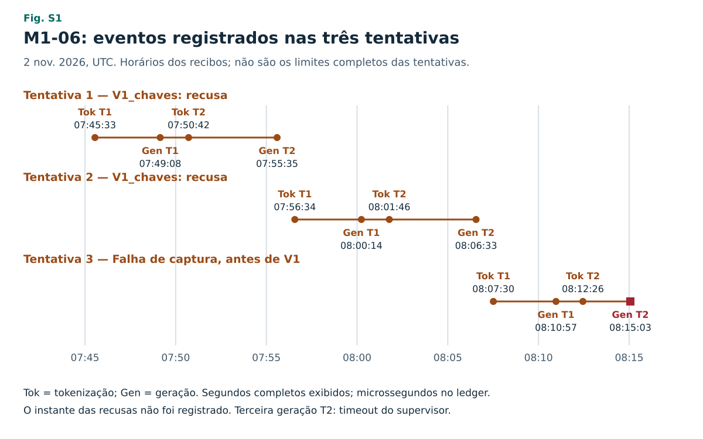
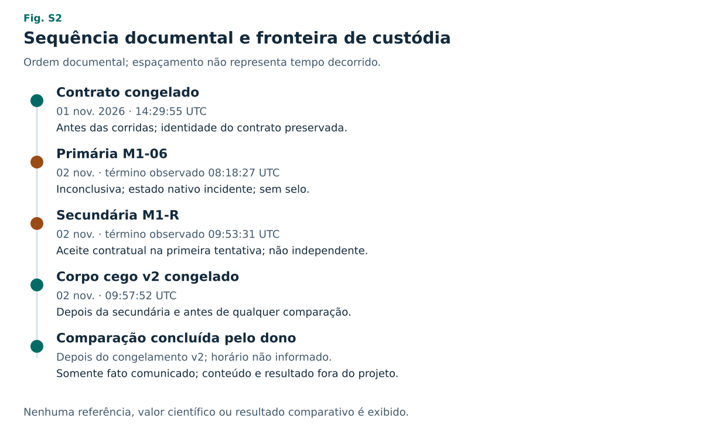

# Material suplementar — registro editorial e trilha de auditoria

**S1. Edição bilíngue de 2 de novembro de 2026.** Este suplemento acompanha os textos português e inglês, que têm o mesmo conteúdo científico. É material de revisão no repositório privado. A publicação de cada código/registro depende da seleção do dono; presença nesta trilha não constitui liberação pública. Não contém referência reservada, resultado científico, anexo ou resultado da comparação do guardião.

## 1. Origem e separação entre congelamento e edição

O corpo cego v2 foi congelado às **2026-11-02T09:57:52.085659Z**, depois do desfecho secundário e antes de qualquer comparação. Seu arquivo permanece intocado. O congelamento editorial posterior a uma corrida não é pré-registro prospectivo dessa corrida. O contrato e as autorizações anteriores às execuções são identificados separadamente abaixo.

| Objeto | Identificação |
|---|---|
| Arquivo fonte v2 | `docs/rascunhos/ARTIGO-B08-estrutura.md` |
| Commit da fonte | `b3bdc12a9a571fd6026bd58a5dcc7e2b11532e11` |
| SHA-256 do arquivo, 32083 bytes | `1ddd2f873a330d13bd25f2209ab5968dd2344c4593a782076e35f6b87acc56d4` |
| Corpo antes do marcador do anexo, bytes 0–30852 | `b55c16150a709d433c1c000344d5bdcbd9d25ee3b318fb0f7f3af14f609d9a65` |
| Recibo v2 | `docs/evidencias/bloco5-2026-10-31/m1-corpo-cego-v2-congelamento.json` |
| SHA-256 do recibo v2 | `5978333743da2fba1f65ddc763f80671bf7aec733610f3bb982d79ac5142e6cd` |
| Revisão posterior v2/pacote | `dbfd1419781d85ead6a15e47592a7d3f68ef5011` |

O recibo v1 e todas as versões anteriores permanecem preservados. A edição de publicação reorganiza a v2, acrescenta declarações e identifica fatos administrativos posteriores: revisão do desfecho secundário, revisão da v2 e informação do dono de que a comparação foi concluída. Nenhum desses fatos modifica resultado científico, primária, secundária ou tolerância. As diferenças são registradas em `ARTIGO-M1-publicacao-mudancas.json`.

## 2. Registro anterior às execuções

| Registro | Data documental UTC | SHA-256 |
|---|---|---|
| Congelamento do contrato/escopo M1 | 2026-11-01T14:29:55.876806Z | `0abf77a2d59e1aa56c6d2853b82d5a7c37044a9f5d742b349870d542f42dc5bb` |
| Contrato identificado nesse congelamento | Mesma fixação | `17929806202c7a4ceb2bb752996eeffac7af9e001943938d4422a01f5216af63` |
| Escopo identificado nesse congelamento | Mesma fixação | `abe6370ea2ba2292f6f36f6149455d2f825bc6759ce9aef6602da5ba091eddc7` |
| Critério CPU01: registro dos bytes atuais | 2026-11-02T00:08:45Z | `5d53ae937e4e7ca197fecd0fc756ff5bbd64e17fa3db8373086abaaf2791a9d1` |
| Critério CPU02: registro dos bytes atuais | 2026-11-02T02:46:59Z | `280d14b305f831957c25075d772716792d1d895fe1cb593c56f8d233b052680b` |

Caminhos: `docs/evidencias/bloco5-2026-10-31/m1-congelamento.json` e `docs/decisoes/DT-B05-CRITERIO-CPU-01.json` / `DT-B05-CRITERIO-CPU-02.json`. Datas dos critérios acima são marcos Git dos bytes, não uma inferência sobre quando a ideia surgiu. Commits: congelamento `c425553445064f4c5f746d2b8ffbb33665997d72`; CPU01 `e60c1093a9c62f0b896e091a4aad45218787e75b`; CPU02 `93519769f87a4a2d4db8cd464a2803670eea6b5e`.

Os critérios CPU fixam três tarefas, três repetições, limiar 1,0 (nove acertos para aprovação), 128 tokens de saída, contexto 4096 e 900 s, carregamento incluído. São qualificações distintas, com respostas fixadas antes de cada execução; CPU02 é posterior à reprovação CPU01. Nenhuma resposta de tarefa é reproduzida aqui.

A tolerância de 1% é preservada no relato e no ato 07 anterior à secundária. O contrato pinado permanece idêntico nos manifestos 04–07. Esta preparação editorial não abriu o pacote científico para reinterpretar a fórmula da tolerância: não se inventa distinção entre erro relativo e absoluto. A condição matemática permanece nos bytes do contrato autorizado.

## 3. Modelo, runtime e parâmetros

Os valores seguintes provêm da DT e dos pins posteriores de manifestos já existentes. Esta edição não baixou pesos, executou binários nem refez a medição de arquivos grandes. Campos históricos “proposto” da DT não são tratados como prova de execução; os recibos vinculam as execuções às identidades posteriores.

| Componente | Versão ou identidade |
|---|---|
| Modelo avaliado | Qwen3.5-9B; `Qwen3.5-9B-Q4_K_M.gguf` |
| Distribuição GGUF | `lmstudio-community/Qwen3.5-9B-GGUF@1379f25c6b505a3fc737bd7818cb09389cf807c1` |
| Tamanho e quantização declarados | 5627044256 bytes; Q4_K_M, 4 bits |
| Licença declarada da distribuição | Apache-2.0; sujeita aos termos dos artefatos |
| Runtime | `ggml-org/llama.cpp`, build b11960, commit `8642541b255bfb5dc39cd351a178be09013a55d6` |
| Build: publicação registrada | 2026-10-28T12:45:39Z |
| Arquivo distribuído | `llama-b11960-bin-ubuntu-x64.tar.gz`, 22686210 bytes |
| Renderizador | Jinja2 3.0.3; ImmutableSandboxedEnvironment; StrictUndefined |
| Execução | CPU; perfil sem raciocínio; GPU layers 0; flash attention off |
| Amostragem | temperatura 0; seed 1; top-k 1; top-p 1,0; min-p 0; repeat penalty 1,0 |
| Batch / ubatch | 512 / 512 |
| Threads de inferência e batch | `-t3` / `-tb3` |
| Limite OpenMP | `OMP_THREAD_LIMIT=3` |
| Tarefas totais | `TasksMax=6`, `pids.max=6`, incluindo principal, auxiliares e descendentes |
| Quota CPU | 300% |
| Memória | MemoryHigh 7G; MemoryMax 8G; MemorySwapMax 0; Nice 10 |
| Contexto M1 | 8192; margem 4: P + reserva ≤ 8192 − 4 |
| Geração M1 | turno 1 ≤ 512 tokens; turno 2 ≤ 2048 tokens |
| Tempo M1 / Python | 30 min globais / 10 s por execução Python admitida |

Três threads OpenMP não significa três threads totais e não limita sozinho pthreads ou logging. A definição foi corrigida explicitamente no ato de preparação e preservada nos atos 04–07. O tokenizador pode inicializar contexto/pool mesmo em vocab_only; não se afirma ausência desse comportamento. Estes são controles fixados, não novos testes operacionais desta edição.

| Artefato pinado | SHA-256 |
|---|---|
| GGUF | `cd76ec205963b3b33350093e6904d9de16c4e666fd104e1f632d25c7f15f2a13` |
| Distribuição runtime | `31cc3a6bc638ac6c48dc4b1b74888f1eaadf3d14227c1e5f67daf9a49541d97a` |
| llama-completion | `7119bef261611b26f326f7c4da4dc3fdeb7bb28e2faf1ec392bda7b21215ef52` |
| llama-tokenize | `712076edf65a35a84188df933912d9e735758fa7bdffb9796287adfadf4263a3` |
| Template | `a4aee8afcf2e0711942cf848899be66016f8d14a889ff9ede07bca099c28f715` |
| Perfil CPU | `29e629104005cbb06e721fcec65fe34673458f6d7780bb67021b27502e18bd69` |
| Perfil M1 | `805c432a9e97dadfc6d505c9f563dcbc8a125cf515e5b5ad2eb0f2043e932d62` |
| DT executor | `f0e619dff820c5d61340a8131507cda9e8e022cc26f642bb245e59d603ec4441` |

## 4. Cronologia e desvios

Todos os horários são UTC de 2/11/2026, salvo indicação. Horários de despacho/observação externa não são usados para recalcular a duração monotônica nativa.

| Evento | Ato anterior e horário | Registro posterior e significado |
|---|---|---|
| Incidente 04 | `cecc49a409417f3d89a2070173ddccde1b221591`, 05:24:29 | 05:47:15.201874–05:52:19.262794; render do turno 2 falhou por campo opcional tool_calls com StrictUndefined, após operações reais. |
| Incidente 05 | `16cac1fb0226f867f4b8d537420c1797539493cf`, 06:45:09 | 06:50:04.580359–06:50:15.716286; lock externo duplicado, zero operações do modelo. |
| Primária 06 | `62d29453a0eb29a85dd7b6eff966a6570a852d1e`, 07:40:30 | Pré-lançamento 07:44:44.335589; conclusão observada 08:18:27.548871; duração nativa 1801,921 s. Inconclusiva, sem retry externo. |
| Análise de formato | Decisão posterior à falha, pedidos cd9e4da/aff306f | Somente chaves e booleanos; fundamentou intervenção, não reclassificou primária. |
| Secundária 07 / M1-R | `6152df9c80665072a3b74ec5af078f03dc199463`, 09:37:42 | Despacho 09:41:50.642594; conclusão observada 09:53:31.935599; duração nativa 677,731 s. Aceita na primeira tentativa. |
| Corpo cego v2 | Congelado 09:57:52.085659 | Fixado após M1-R e antes de comparação; preservou v1. |
| Comparação do guardião | Informação posterior do dono, pedido 0e40a23 | Somente fato de conclusão registrado; conteúdo não recebido. |
| Pedido formal B05 | Juiz 12:36:32 | Alvo 7bafddb25670a6bbd026c5e15aec7a9e06d823e0; não é fechamento. |

Candidatas 05/06/07: `667e65f64acad24ad5eb5c6bd47707c7d1030367`, `729307b54d61d2789d157c84e33d2e107e04ebc4`, `4552b888d93077a79e38ddf85a98d26125465480`. O recibo 04 identifica source_head 73a867e70dfe2b50bac50ac1600022bf69317791; ele não é renomeado aqui como candidata.

### Manifestos e recibos preservados

| Execução | SHA-256 manifesto | SHA-256 recibo administrativo |
|---|---|---|
| 04 | `d87d110c78b538fdf1aeee5d1b069104047c0e4d660d237ab030af15a39f5a67` | `e31692633a150fabc3caed5dfa10b439cbae812295b3ea00ff80631a48dfeb14` |
| 05 | `68f0af302a19dbbaf26f7fc2bf3025775a38af9fd6c497a6502a37ec1c907dcf` | `33d3beec4029509c79e652fbd830f873089c3aa0173b79e5f8301bdc5f83d20f` |
| 06 | `7f858a7282a93eee9ad4d4abe014a6767b8c95a04e267037511cf1e36035b5a8` | `14a749df2647ff3e96a59edf4b0f886b9ec5703efe8a6b248317900809b3ab77` |
| 07 | `7e8df498e698afb1dc3a5911541119c6faca09086c9048a3211f4f204022a478` | `3d05ab94e26dead936cdd4d654fe5f8f1122b9fcd99c11e16ac2fe91e9d5daf8` |

Caminhos: `docs/decisoes/B05-CPU-M1-NN-manifesto.json` e `docs/evidencias/bloco5-2026-10-31/cpu-m1-NN-m1/recibo.json`. A leitura editorial desses metadados não é nova execução nem nova verificação de cada assinatura histórica.

## 5. Revisões e trilha de alegações

- Primária 06: parecer 9666ba1 sobre desfecho e d4a31c0 sobre classificação das recusas/artigo. Inconclusiva por 30 min sem saída aceita, duas recusas V1; estado nativo incidente preservado.
- Análise estrutural: `cpu-m1-06-m1/analise-falha-formato.json`, revisão c67d551. Escopo restrito a chaves/booleanos; não é auditoria semântica integral nem comparação científica.
- Saídas finais das duas recusas: mesmo SHA-256 `8bd582f25ef3eedc91edd6cce9f9dc91c04d5d8da4d0058fbd8e9673f5d6dd40`, após remover somente sufixo EOG comprovado; sem normalizar JSON.
- Secundária: revisão `2734aa97978a586a287d2f8bc4d23f58f7adb7be`, em `coord/outbox/claude/sc-b05-cpu-m1-07-m1-revisao.json`; selo `e9346296c289d076b891d0ca26acd278aa664ebec833ad167aa3155cfbbed59a`. Aceite contratual não é correção científica.
- Corpo v2/pacote: revisão `dbfd1419781d85ead6a15e47592a7d3f68ef5011`. Não autoriza leitura do anexo reservado.
- Emenda exclusivamente de forma: candidata 92dafca; manifesto 4209fe3e; ato 8e830a9; revisão 09c78b6. Critério, limiar, tarefas, REPROVADO 6/9, plano e corpo v2 preservados.
- CI final da emenda: run 41441645358, tentativa 1, testes 1016/1016 em 18 suítes; workflow failure somente por autoridade pre-ato. Sem nova CI. A instalação posterior foi validada; conferência histórica global teve timeout 90 s e não foi chamada de aprovação integral.
- Fechamento: pedido canônico `blocos/B05/revisoes/pedido-7bafddb25670.json`, SHA-256 `9b54c2149427055e53300ee1e3f5b19c4507e3a970f0354fdb040c5676cb6347`. Revisão formal do Claude recebida com achado administrativo aberto. A revisão do Antigravity está bloqueada pelo pacote de 4541 caminhos contra teto 1000 e foi adiada pelo dono até depois da entrega do artigo; nenhum consumo ou elevação de limite. São pendências administrativas, não novos resultados científicos.

O arquivo `ARTIGO-M1-publicacao-mudancas.json` liga os hashes das duas versões e deste suplemento à fonte congelada. A fidelidade da candidata 7060145 foi aprovada pelo Claude com dois ajustes de forma (parecer 78c64de; horário corrigido em cf6aab5). Os ajustes e as figuras do novo pedido são enviados como delta editorial para revisão. Essa revisão não substitui as duas revisões formais do B05.

## 6. Matriz REFORMS: 32 itens

Fonte: Kapoor et al., 2024, tabela 1, DOI [10.1126/sciadv.adk3452](https://doi.org/10.1126/sciadv.adk3452). Descritores abaixo são paráfrases breves; a análise de aplicabilidade é deste estudo. Não se reproduz a tabela original integral, não se altera sua licença CC BY-NC 4.0 e não se declara certificação. **A**: aplicável e relatado; **P**: aplicável parcialmente, com limite; **N/A**: não aplicável ao componente indicado. “Relatado” não significa prova integral ou disponibilidade pública.

| ID original | Tema resumido | Aplicação | Evidência/justificativa própria e limite | Localização |
|---|---|---|---|---|
| 1a | Universo | A | Uma etapa intencional, não população de problemas. | Métodos; limitações |
| 1b | Escolha do recorte | A | CPU barata e determinística, superfície reservada reduzida; seleção humana. | Métodos; contrato S1 |
| 1c | Papel do modelo | A | Avaliar produção de código/objeto sob contrato; não alegar superioridade. | Introdução; métodos |
| 2a | Identificação dos dados | P | Pacote/contrato fixados por hash; conteúdo e acesso sujeitos à liberação. | S1 seções 2–3 |
| 2b | Código e versão | P | Fontes/commits e runtime identificados; disponibilização pública pendente. | S1 seções 3–5 |
| 2c | Infraestrutura | P | CPU, isolamento, parâmetros e limites registrados; não houve reprodução por terceiro. | S1 seção 3 |
| 2d | Instruções de execução | P | Comandos fixados nos atos; liberação e documentação pública dependem do dono. | S1 seção 4 |
| 2e | Reprodução automatizada | P | Harness versionado e registros preservados; nenhuma nova corrida reprodutora nesta edição. | S1 seções 4–5 |
| 3a | Origem dos dados | P | Guardião separa entradas permitidas; proibição de acesso a referência; não há independência pessoal. | Métodos: custódia |
| 3b | Amostragem | A | Seleção intencional de um caso, sem amostragem probabilística. | Métodos: desenho |
| 3c | Adequação | P | Contrato delimita etapa; qualificação sintética não prova capacidade científica geral. | Resultados: qualificações |
| 3d | Definição de desfecho | A | Aceite contratual V1–V7 separado de correção científica e comparação. | Métodos; resultados |
| 3e | Tamanho observado | A | Uma etapa; três tentativas internas primárias e uma secundária; dependência explícita. | Resultados |
| 3f | Ausências | A | Sem selo primário; interrupção e incidentes preservados, não imputados. | Resultados; S1 seção 4 |
| 3g | Representatividade | A | Sem afirmação de representação de modelos, artigos ou problemas. | Limitações |
| 4a | Exclusões | A | Recusas e incidentes permanecem; material reservado excluído por desenho, não por desempenho. | Métodos; resultados |
| 4b | Dados inválidos | A | V1 recusa esquema; causa operacional e capturas distinguidas. | Resultados: primária |
| 4c | Transformações | A | Hash das saídas remove somente EOG comprovado; sem normalizar JSON. Adaptador opcional declarado no incidente 04. | S1 seções 4–5 |
| 5a | Treinamento | N/A | Nenhum treino ou ajuste de pesos neste estudo; modelo pré-treinado identificado. | S1 seção 3 |
| 5b | Escolha do modelo | P | Decisão humana manteve modelo local; sem comparação sistemática de alternativas. | Métodos; limitações |
| 5c | Partições de avaliação | N/A parcial | Sem conjunto de treinamento/validação/teste criado aqui; avaliação contratual descrita. | Métodos; resultados |
| 5d | Seleção | A | Primária preservada; qualificação 2 e intervenção secundária posteriores claramente identificadas. | Métodos: desvios |
| 5e | Ajuste de parâmetros | N/A parcial | Sem tuning de treino; parâmetros de inferência fixos e intervenção de instrução pós-hoc declarados. | S1 seção 3; métodos |
| 5f | Comparadores | P | Sem baseline que sustente eficiência/superioridade; secundária não é comparação causal controlada. | Discussão |
| 6a | Treino versus teste | N/A parcial | Não há treino local; desconhecimento do material pelos pesos não foi demonstrado. | Limitações |
| 6b | Dependências | A | Hashes iguais e temperatura 0; tentativas não são réplicas independentes. | Resultados: primária |
| 6c | Entradas legítimas | P | Contrato e regra de cegamento definidos; não se alega prova integral de isolamento. | Métodos: custódia |
| 7a | Métricas | A | Contagens/tempos e V1–V7 descrevem contrato; não medem correção científica. | Métodos; resultados |
| 7b | Incerteza | N/A parcial | Sem IC estatístico ou variância estimada; desenho de caso único não permite inferência populacional. | Limitações |
| 7c | Testes estatísticos | N/A | Não foram realizados testes de hipótese; não há p-valores ou significância alegada. | Discussão; limitações |
| 8a | Validade externa | A | Sem generalização para outras etapas, modelos, ambientes ou GPU. | Limitações |
| 8b | Fora do domínio | A | Sem alegação de descoberta, reprodução integral, autonomia geral ou validação física. | Introdução; conclusão |

## 7. Normas editoriais e limites da consulta

- ICMJE e COPE: ferramentas de IA não são autoras; declarar seus papéis e manter responsabilidade humana. A confirmação humana final ainda é pendente. CRediT descreve contribuições e não decide sozinho autoria. Não há declaração de análise formal ou validação humana que não tenha ocorrido.
- A posição COPE foi identificada pelo DOI e pelo texto oficial indexado; a abertura direta devolveu 403. Não se afirma leitura integral dessa página nem autorização universal de tradução. A página ICMJE consultada foi a versão de janeiro 2026.
- ISO 80000-1:2022: catálogo/escopo públicos consultados; texto integral pago não foi consultado. Usa-se a Brochura SI do BIPM como referência aberta adicional; não se certifica conformidade integral com ISO.
- REFORMS foi conferido na tabela 1 do artigo publicado, em [cópia institucional](https://pure.hw.ac.uk/ws/portalfiles/portal/126539339/sciadv.adk3452.pdf). A aplicação a modelo fundacional sem treinamento local exige julgamento de relevância, explicitado nos N/A parciais.
- NASEM e COS fundamentam separar reprodução, réplica, planejamento prévio e análise exploratória. Congelamento editorial posterior não transforma decisão pós-hoc em hipótese prospectiva.
- A identificação bibliográfica Wurzel/Hsu foi preservada do corpo congelado. Não se abriu seu conteúdo ou resultado para esta edição. A URL do runtime fixado não foi recuperada pela ferramenta web nesta rodada; versão/commit/hashes são transcritos dos registros existentes. O repositório GGUF na revisão fixada foi aberto para identificação bibliográfica, sem download.
- A licença CC BY 4.0 é sugestão para texto original liberado pelo titular, não para o acervo privado nem para materiais de terceiros. Pesos, software e tabela REFORMS conservam suas licenças.

## 8. Preenchimento humano e entrega bilíngue

Campos pendentes nos dois textos: nome, ORCID, afiliação, contato; contribuições efetivas; revisão e responsabilidade final; financiamento; conflitos; exigências éticas/institucionais; perímetro público de código/registros; licença; idioma de registro e destino. São campos de minuta, não pedido para enviar o anexo aos agentes.

**English reading note.** This shared supplement records administrative provenance, artifact identifiers, exact configuration, timeline, and an applicability assessment of all 32 REFORMS items. It contains no restricted reference, scientific output value, or guardian comparison outcome. A means applicable and reported; P means partially addressed with an explicit limitation; N/A is limited to the named component. Reporting is not certification. The two main manuscripts carry the same scientific content and both structured abstracts. The owner completes authorship, funding, conflicts, access, licensing, and publication decisions, and writes/translates the guardian appendix outside this workstream. No agent submits or publishes the article.

O suplemento e a minuta não são B08 canônico, fechamento B05, licença de inferência, autorização GPU ou dispensa de revisão. Prazo editorial 17:00 UTC preservado.

## 9. Figuras de apresentação e geração dos PDFs

As figuras F1–F4 têm versões SVG em português e inglês em artigo/figuras/. São apresentações dos metadados permitidos, sem referência, resultado científico, texto do modelo, código gerado ou stdout. O arquivo dados-permitidos.json liga cada contagem aos recibos administrativos por caminho e SHA-256; gerar_figuras.py reproduz as figuras sem acesso a dados científicos. Os horários da F3 são operations[].utc, agrupados pelo identificador da tentativa e ordenados cronologicamente. Não são tempos completos de tentativa; não se inventa o instante das recusas. A F4 usa observação externa do término das corridas e distingue esse horário da duração monotônica.

Mudanças de apresentação e o marcador externo do anexo seguem o pedido assinado 953f71e. O marcador contém a declaração fornecida pelo dono para sua montagem final; não comprova acesso, escrita ou inserção do anexo por agentes. A figura comparativa do guardião permanece fora deste projeto.

O corpo português e o corpo inglês serão convertidos em PDF somente após a aprovação do delta pelo Claude. A verificação na VPS não encontrou reportlab, weasyprint, Pandoc ou Poppler; nenhum pacote foi instalado. Foi solicitado ao Claude o caminho de geração na nuvem previsto pelo dono, com figuras SVG incorporadas, conferência visual das páginas e hashes dos PDFs no ledger. Nenhum agente recebe ou junta o PDF do anexo; a montagem final pertence ao dono.

Os PDFs de conferência da edição bb96b53 foram gerados na nuvem pelo Claude (commit 3e6a3ed, recibo docs/rascunhos/pdf/recibo-render.json), com pandoc, Chromium por Playwright e poppler já presentes; nada foi instalado.

## 10. Versão de conferência v3: reestruturação editorial

A pedido do dono, depois de uma releitura com foco em leitores sem contexto do projeto, o Claude reestruturou o texto principal nas duas línguas. Desfechos, números, classificações e limites da v2 não mudaram. As mudanças foram:

- título e resumos em linguagem sem códigos internos;
- seção 1 com o contexto de sistemas de pesquisa com IA, as contribuições e um glossário (Quadro 1);
- seção 2 de trabalhos relacionados, com as referências 13 a 18;
- seção 3 com a arquitetura do sistema (papéis, plano e juiz, execução isolada, custódia e registros) e a nova Figura 1, em nível funcional, sem endereços, chaves ou código;
- seção 4.1 com a descrição da tarefa tirada do escopo e do contrato permitidos (grandeza, definição, unidades e procedência das entradas), sem os valores numéricos, a saída do modelo ou a comparação, que ficam no anexo do guardião;
- seção 4.4 com as condições de parada do contrato e a tolerância interna de V4; seção 4.5 com o desenho da primeira qualificação (três tarefas inventadas, três repetições, acerto exigido em todas as nove saídas), tirado do critério fixado;
- renumeração das figuras: F0 passa a Figura 1; F1 e F2 passam a Figuras 2 e 3; F3 e F4 passam a Figuras S1 e S2 deste suplemento; os rótulos dentro dos SVG foram atualizados pelo mesmo gerador, sem outra mudança de bytes;
- a frase de situação editorial saiu do corpo e foi para a seção 12 deste suplemento.

## 11. Figuras suplementares

**Figura S1. Eventos das três tentativas da M1-06.** Horários UTC dos recibos de tokenização e geração, exibidos em segundos completos. Eles não definem os limites temporais completos de cada tentativa; os instantes das recusas não foram registrados. A terceira geração do turno 2 terminou em falha de captura por timeout. Os microssegundos e os vínculos por tentativa estão em artigo/figuras/dados-permitidos.json.

**Figura S2. Cronologia documental e fronteira de custódia.** A ordem entre contrato, corridas, congelamento do corpo v2 e comparação é apresentada sem escala temporal proporcional. Para as corridas, aparecem horários de observação do término, não duração nativa. O dono comunicou a conclusão da comparação depois do congelamento v2; nenhum horário específico, conteúdo ou resultado comparativo foi recebido.

*English versions of Figures S1 and S2: artigo/figuras/F3-tentativas-en.svg and artigo/figuras/F4-cronologia-en.svg.*

## 12. Situação editorial

O artigo deriva da v2 congelada e registra separadamente atualizações administrativas posteriores. A revisão formal do Claude sobre o fechamento do bloco 5 foi recebida com achado administrativo aberto; a do Antigravity foi adiada pelo dono até depois da entrega do artigo. A fidelidade da edição 7060145 foi aprovada pelo Claude com dois ajustes de forma; o delta de figuras bb96b53 foi aprovado e convertido em PDF de conferência; a reestruturação v3 foi feita pelo Claude a pedido do dono e segue para conferência de fidelidade pelo Codex e leitura do dono. A matriz REFORMS é uma avaliação de aplicabilidade, não certificação de conformidade integral.

## 13. Correção v3.1: autorização da corrida e fechamento do bloco

A conferência independente do Codex (achado CX-ART-M1-V3-01, 2eca2a7) apontou que a Figura 1 e sua legenda punham as duas revisões externas como condição da corrida. No fluxo real, a corrida exige ato do dono, parecer assinado do Claude sobre o código e a preparação, bytes fixados por hash e qualificação aprovada; as revisões do Claude e do Antigravity são para fechar o bloco, depois das corridas, e a M1-R foi aceita com a revisão de fechamento do Antigravity ainda pendente. Na v3.1 foram corrigidos a Figura 1, sua legenda, a seção 3.2, o glossário (juiz e tentativa) e a expressão "fechar cada etapa" nos resumos, que passou a "fechar cada bloco de trabalho". Desfechos, números e limites não mudaram.
